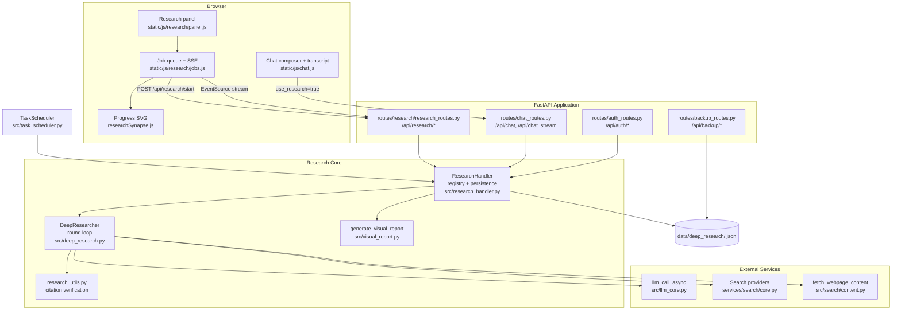
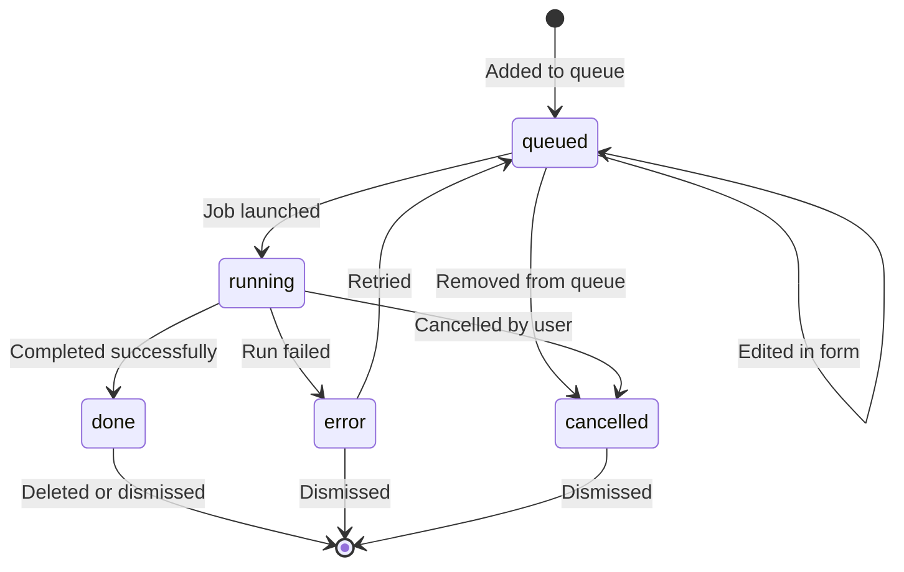
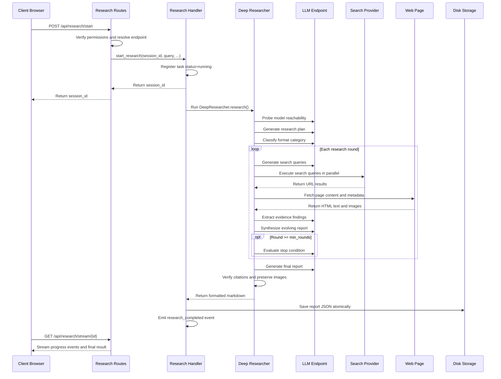

# Deep Research

Deep Research is Zephyrus's multi-round, LLM-guided web research subsystem. You provide a question; the subsystem plans a strategy, generates search queries, extracts evidence from web pages, updates an evolving report across rounds, decides when to stop, and compiles a comprehensive final report with inline citations. The completed report is saved to disk, rendered as a standalone HTML visual report, and indexed in the searchable Library.

The full pipeline (planning, query generation, search, extraction, synthesis, stopping decisions, final reporting, persistence, visual reports, library management, and cancellation) is fully implemented and exercised by automated test suites.

## Terminology

| Term | Meaning in this subsystem |
| --- | --- |
| Job / run | A single execution of the research loop for a given query, identified by a session id. |
| Session id | The unique job identifier. Prefixed with `rp-` plus 12 hex characters from the panel, the chat session id when started from chat, or the task id when started by the scheduler. |
| Round | One iteration of planning queries, searching, extracting evidence, and synthesizing findings. Rounds start at index 1. |
| Plan | The structured decomposition of the query into sub-questions, topics, and success criteria. Created once and referenced by query-generation calls. |
| Query | An individual search string generated by the model during a round. |
| Finding | Extracted source data containing `rational`, `evidence`, `summary`, source URL, title, and page `og_image`. |
| Source | A finding normalized to `{url, title, image}` for display, deduplicated by URL and filtered for quality. |
| Evolving report | The working report rewritten after each round during synthesis. It informs stopping evaluations and seeds the final report. |
| Category | Output format override: `product`, `comparison`, `howto`, or `factcheck` (defaults to general/auto). |
| Phase | Current execution state: `probing`, `planning`, `searching`, `reading`, `analyzing`, `writing`, `deciding`, `warning`, or `error`. |
| Synapse | The interactive SVG graph in the UI displaying query roots, round branches, and source leaves. |
| Consumed | A persisted report read via `POST /api/research/result/{id}`. Consumed reports are hidden from status endpoints but remain on disk. |
| Checkpoint | Ephemeral round snapshot (`.checkpoint`) written to disk after each round to enable partial-report salvage without creating unfinalized `.json` reports. |
| Ephemeral / Incognito | An in-memory research job (e.g., launched from an incognito chat session) that is never saved to disk and is purged after 300 seconds. |
| Time reserve | A portion of the cooperative `max_time` budget (default 45s) held back so the final report and citation verification can complete before the wall-clock timeout. |

## Overview

### What it does

A research job runs as a background `asyncio` task owned by a user and tracked by session id. The core loop lives in `src/deep_research.py` under the `DeepResearcher` class. The execution model follows an iterative research pattern: Plan, Think, Search, Extract, Synthesize, Decide.

### Problem it solves

Single-turn web searches often fail on complex questions that require multi-source verification, comparative analysis, or deep topic exploration. Deep Research turns a complex question into an iterative investigation where the model determines query strategy and evaluates evidence sufficiency across multiple rounds.

### Role in Zephyrus

Deep Research operates alongside Chat, Agent, and Cookbook as a primary tool surface. It provides:
- A dedicated modal panel (`#research-overlay`) and client controller (`static/js/research/panel.js`).
- A REST and Server-Sent Events namespace (`/api/research/*`).
- On-disk report persistence in `data/deep_research/`.
- Access control enforced through user privileges (`can_use_research`).

It connects with several other application surfaces:
1. The chat composer research mode, which streams progress events directly into chat transcripts.
2. Agent tools (`trigger_research` and `manage_research`), allowing autonomous agents to run background investigations.
3. The inline chat endpoint (`POST /api/chat`), which runs synchronous research and injects the output into the prompt.
4. The background task scheduler, which executes recurring research jobs and stores the results in the Library.

### Source code organization

| Layer | File path |
| --- | --- |
| Research engine loop | `src/deep_research.py` |
| Text, citation, and quality utilities | `src/research_utils.py` |
| Job registry, lifecycle, and persistence | `src/research_handler.py` |
| HTTP routes | `routes/research/research_routes.py` |
| Legacy route shim | `routes/research_routes.py` |
| HTML report generator | `src/visual_report.py` |
| Extraction system prompts | `src/goal_based_extractor.py` |
| Agent tool interfaces | `src/tools/research.py` |
| Web UI panel controller | `static/js/research/panel.js` |
| Web UI job state machine | `static/js/research/jobs.js` |
| Tree visualization | `static/js/researchSynapse.js` |
| Service compatibility facade | `services/research/service.py`, `services/research/research_handler.py` |

## Key Capabilities

| Capability | Status | Implementation details |
| --- | --- | --- |
| Multi-round research loop | Implemented | `DeepResearcher.research` in `src/deep_research.py`. |
| Pre-search strategy planning | Implemented | `DeepResearcher._create_plan` generates sub-questions, topics, and success criteria. |
| Query deduplication across rounds | Implemented | `DeepResearcher._generate_queries` tracks visited queries and requests structured JSON. |
| Multi-engine search fallbacks | Implemented | `DeepResearcher._search` resolves provider chains dynamically. |
| Bounded parallel extraction | Implemented | `DeepResearcher._search_and_extract` bounds concurrency via `asyncio.Semaphore`. |
| Shared endpoint semaphores | Implemented | `ResearchHandler._shared_semaphore` pools semaphores per endpoint to prevent overloading local LLM servers. |
| Quality and boilerplate filtering | Implemented | `is_low_quality` in `src/research_utils.py` discards generic error pages. |
| Verified citations with image preservation | Implemented | `verify_citations` in `src/research_utils.py` validates URLs while preserving markdown images (`(?<!\!)\[...`). |
| Category formatting templates | Implemented | `CATEGORY_PROMPTS` formats product, comparison, how-to, and factcheck reports. |
| Dynamic LLM stopping decisions | Implemented | `DeepResearcher._should_stop` evaluates evidence sufficiency and gaps once minimum rounds pass. |
| Minimum length expansion | Implemented | `DeepResearcher._final_report` triggers an expansion call if word count is below 400. |
| Multi-turn continuation | Implemented | Accepts `prior_report`, `prior_findings`, and `prior_urls` to build upon existing jobs. |
| Persistent task registry | Implemented | `ResearchHandler._active_tasks` manages tasks across client reloads. |
| Ephemeral / Incognito runs | Implemented | In-memory execution without disk persistence for incognito chat sessions, purged after 300s. |
| Round checkpointing & partial salvage | Implemented | `.checkpoint` files save in-progress state per round; salvaged into full reports on timeout or error. |
| Memory leak prevention & reaper | Implemented | `ResearchHandler._ensure_reaper` sweeps finished tasks after TTL and runs retention purges; `shutdown()` cancels cleanly. |
| Server-Sent Events progress | Implemented | `GET /api/research/stream/{session_id}` streams updates in real time with event-driven wakeup. |
| Immediate cancellation response | Implemented | `cancel_research` wakes SSE listeners immediately and aborts active tasks. |
| User-scoped persistence | Implemented | `ResearchHandler._save_result` stores reports by session id with owner metadata and atomic JSON replacement. |
| Standalone visual reports | Implemented | `generate_visual_report` in `src/visual_report.py` produces styled HTML pages. |
| Report Library management | Implemented | `routes/research/research_routes.py` provides listing, filtering, search, and deletion with mtime caching. |
| Follow-up chat spinoffs | Implemented | `POST /api/research/spinoff/{session_id}` initializes chat sessions with report context. |
| Autonomous agent tools | Implemented | `trigger_research` and `manage_research` in `src/tools/research.py` with multi-tenant owner scoping. |
| Background task scheduler | Implemented | `TaskScheduler._execute_research_task` routes through `ResearchHandler` with error propagation. |
| Backup and restore support | Implemented | `routes/backup_routes.py` exports and imports user research reports. |
| Account deletion data cleanup | Implemented | `admin_delete_user` removes associated research reports on disk via `delete_owner_data`. |
| Visibility-aware client polling | Implemented | `jobs.js` pauses polling when tabs are inactive and resumes on visibility change. |

## Architecture

### System architecture



`DeepResearcher` does not interact with the database or file storage. File operations and registry management remain in `ResearchHandler`, while `DeepResearcher` communicates progress through callbacks.

### Architectural boundaries

- Engine vs Handler: `DeepResearcher` has no knowledge of HTTP sessions, user accounts, or storage files. It accepts endpoint configuration and emits progress callbacks.
- Handler vs Routes: `ResearchHandler` owns active task management, concurrency semaphores, and file persistence. Routes enforce authentication, ownership, and request validation.
- Server vs Client: The server maintains authoritative state. The client caches active jobs and remembers dismissed cards in browser `localStorage`.
- Tenant Isolation: User separation is enforced at route and handler layers by matching the authenticated `owner` username.

### Key design decisions

1. Background Task Registry: Jobs run in asynchronous background tasks. Clients receive a session identifier immediately and can disconnect or reconnect without interrupting the execution.
2. Dual Time Budgets: The subsystem uses a cooperative per-round budget (`max_time`) evaluated between rounds, along with an enforced wall-clock limit (`research_run_timeout_seconds`) wrapped in `asyncio.wait_for`.
3. Shared Endpoint Concurrency: Concurrency semaphores are keyed by endpoint and reused across jobs, preventing concurrent runs from overloading local model servers.
4. Fault-Tolerant Partial Salvage: If a task encounters an unhandled exception or times out, the system finalizes and preserves the evolving draft report.
5. Content Framing: Fetched web content is enclosed in `untrusted_context_message` blocks and delivered as user data, isolating untrusted inputs from system instructions.

## User Flow

### Deep Research panel

1. Discovery: The panel opens from the navigation rail (`#rail-research`) or the sidebar button (`#tool-research-btn`).
2. Interface: The modal overlay (`#research-overlay`) displays the research query input and collapsible configuration options.
3. Configuration:
   - Rounds: Auto (default) or fixed from 1 to 20.
   - Format: Auto, Product, Comparison, How-to, Landscape, or Fact-check.
   - Time budget: Quick (2m), Standard (5m), Deep (15m), or Custom minutes.
   - Search engine: Default, SearXNG, DuckDuckGo, Tavily, Brave, Google, or Serper.
   - Model and endpoint: Configured model endpoints.
4. Execution: Starting a job posts to `/api/research/start` and attaches an `EventSource` listener to `/api/research/stream/{session_id}`.
5. Batch Queueing: When multiple jobs are queued, the panel offers parallel or sequential execution.
6. Feedback: The panel displays elapsed time, current round, source counts, an SVG synapse graph, and progress bars.
7. Completion: Finished jobs provide actions for Visual Report, Discuss in Chat, Continue Investigation, Copy Markdown, and Delete.

### Chat integration

When research is enabled in chat:
1. Clarification: If the question is ambiguous, the system asks brief clarifying questions before starting research.
2. Query Synthesis: User input is distilled into a structured research question.
3. Real-Time Streaming: Progress updates stream into the chat view as SSE events.
4. Transcript Persistence: When completed, the report and source metadata are stored as assistant messages in the chat session history.

### Agent tools

Autonomous agents interact with research via two dedicated tools:
- `trigger_research`: Starts background research for a topic and returns an anchor link with a `research_started` UI event.
- `manage_research`: Supports actions for `list`, `read`, and `delete` across stored research reports.

### Scheduled research tasks

Automated research runs via `TaskScheduler`:
- Tasks configured with `task_type="research"` trigger `TaskScheduler._execute_research_task`.
- The scheduler delegates execution to `ResearchHandler.start_research` and awaits the background task handle.
- If the background task finishes with `status="error"`, `TaskScheduler` raises a `RuntimeError` with the failure reason to ensure the scheduler records the task run as failed.
- Tasks enjoy endpoint probing, wall-clock timeout enforcement, external cancellation propagation, and partial error salvage.
- Completed reports are tagged with `category="scheduled"` and saved in `data/deep_research/`.

### Client state transitions



## Internal Execution Lifecycle

### Lifecycle sequence



### Stage details

1. Admission: `POST /api/research/start` verifies user identity and requires the `can_use_research` privilege. Tool requests authenticate via `X-Zephyrus-Owner`.
2. Endpoint resolution: Selects the designated endpoint, falling back through research, utility, default, and chat endpoints.
3. Registration: `ResearchHandler` records the task in `_active_tasks` with status `running` and initializes cancellation events.
4. Probing: A lightweight call tests endpoint responsiveness and authentication. If probing fails, descriptive errors guide endpoint configuration.
5. Planning: `_create_plan` extracts sub-questions, core topics, and success criteria into a reference plan.
6. Category classification: Classifies queries into product, comparison, how-to, landscape, or fact-check formats.
7. Search and extraction:
   - Queries are searched in parallel across the configured provider chain.
   - Pages are fetched with timeouts and parsed to remove boilerplate.
   - Evidence is extracted into structured records containing rationales, evidence quotes, and summaries.
8. Synthesis: The most recent findings update the evolving report draft.
9. Stopping evaluation: Once `min_rounds` are reached, the model assesses whether the evidence sufficiently answers the prompt.
10. Final report generation: Compiles a structured markdown report with table of contents, findings, and verified citations.
11. Citation verification: Validates link URLs against fetched sources while preserving markdown images intact.
12. Persistence: Writes the final report, source list, findings, and metadata to disk.

### Stopping conditions

The research loop concludes when any of these conditions are met:
- Explicit cancellation via client request.
- Cooperative time budget (`max_time`) exceeded at round start.
- No new search queries generated.
- Consecutive empty rounds with no new findings (`max_empty_rounds`, default 2).
- The model evaluates the evolving evidence as sufficient (`_should_stop`).
- Maximum round limit reached (`max_rounds`).

### Continuation runs

Existing research can be extended with follow-up queries:
- Prior findings and report drafts seed the new job context.
- Previously analyzed URLs are excluded from re-fetching.
- The planning stage incorporates prior conclusions to focus new searches.

### Timeouts and limits

| Budget | Default | Configuration source | Enforcement |
| --- | --- | --- | --- |
| Cooperative round limit | 300 s | Request `max_time` | Checked between rounds |
| Wall-clock timeout | 1800 s | `research_run_timeout_seconds` | `asyncio.wait_for` wrapper |
| Final report time reserve | 45 s | `research_final_report_reserve_seconds` | Subtracted from `max_time` before round dispatch |
| Planning call timeout | 90 s | `research_planning_timeout_seconds` | Per-request timeout |
| Query generation timeout | 90 s | `research_query_timeout_seconds` | Per-request timeout |
| Extraction call timeout | 90 s | `research_extraction_timeout_seconds` | Per-request timeout |
| Synthesis timeout | 180 s | Fixed internal limit | Per-request timeout |
| Final report timeout | 180 s | Fixed internal limit | Per-request timeout |
| Endpoint probe timeout | 15 s | Fixed internal limit | Per-request timeout |
| Content cache TTL | 86400 s | `research_extraction_cache_ttl_seconds` | Reused across overlapping queries |
| Report retention | 0 (disabled) | `research_retention_days` | Periodic 6-hour purge sweep |

## Component Breakdown

### DeepResearcher (`src/deep_research.py`)

Core loop coordinator. Handles query planning, web search execution, evidence extraction, report synthesis, and citation verification.

Key parameters:
- `max_rounds`: Maximum search iterations (default 8, panel default 20).
- `min_rounds`: Minimum rounds required before evaluating stop conditions (default 2).
- `max_time`: Maximum cooperative time budget in seconds (default 300).
- `max_urls_per_round`: Total unique URLs fetched per round across all queries (default 8).
- `max_results_per_query`: Search results requested per query string (default 5).
- `final_report_reserve_seconds`: Reserved cooperative time for final report writing and citation verification (default 45).
- `max_content_chars`: Content size cap per page (default 15,000).
- `max_report_tokens`: Token ceiling for synthesis and final reports (default 8,192).
- `extraction_concurrency`: Maximum parallel page extraction calls (default 3).
- `shared_semaphore`: Optional pooled semaphore injected per endpoint to bound server load.
- `checkpoint_callback`: Progress persistence callback storing round state in `.checkpoint` files.

### ResearchHandler (`src/research_handler.py`)

Coordinates background tasks, client SSE streaming, persistence, and cleanup.

Key responsibilities:
- `start_research`: Validates parameters, registers tasks in `_active_tasks`, and starts the background execution task.
- `cancel_research`: Flags cancellation, halts child researcher tasks, and awakens waiting SSE listeners via `progress_event.set()`.
- `_shared_semaphore`: Returns a shared concurrency gate keyed by endpoint to bound parallel worker load across jobs.
- `_ensure_reaper`: Starts a 60-second background maintenance loop executing finished task release, ephemeral cleanup, and retention purging.
- `shutdown`: Cancels and tears down the active reaper task during server shutdown.
- `_write_checkpoint`, `_load_checkpoint`, `_delete_checkpoint`: Persists and purges `.checkpoint` files without polluting `.json` report listings.
- `_salvage_partial`: Reconstitutes evolving findings or checkpoints into a finalized report upon timeout or unexpected failure.
- `_release_finished_tasks`: Manages memory lifecycle and evicts stale in-memory task entries after TTL.
- `delete_owner_data`: Removes persisted user reports on account deletion, guarding against empty identifiers.
- `_save_result`: Persists completed report data to JSON files using `atomic_write_json` and `_secure_chmod(0o600)`.

### Route handlers (`routes/research/research_routes.py`)

Exposes REST and SSE endpoints with authentication and permission checks.

| Method | Endpoint | Purpose |
| --- | --- | --- |
| GET | `/api/research/active` | Lists running tasks for the caller. |
| GET | `/api/research/status/{id}` | Returns current task status and metrics. |
| POST | `/api/research/cancel/{id}` | Cancels an active research task. |
| POST | `/api/research/result/{id}` | Returns report payload and marks it consumed. |
| POST | `/api/research/result-peek/{id}` | Returns report payload without marking consumed. |
| GET | `/api/research/stream/{id}` | Streams live progress via Server-Sent Events. |
| GET | `/api/research/report/{id}` | Serves standalone visual HTML report. |
| POST | `/api/research/{id}/hide-image` | Suppresses specific images in visual reports. |
| POST | `/api/research/{id}/unhide-images` | Clears hidden image rules for a report. |
| GET | `/api/research/library` | Searches and filters saved research records. |
| GET | `/api/research/detail/{id}` | Returns raw persisted JSON record. |
| POST | `/api/research/{id}/archive` | Toggles report archive status. |
| DELETE | `/api/research/{id}` | Permanently deletes a report from disk. |
| POST | `/api/research/start` | Initiates a background research run. |
| POST | `/api/research/spinoff/{id}` | Starts a new chat session seeded with the report. |

### Visual report generator (`src/visual_report.py`)

Builds responsive, standalone HTML visual documents:
- Automatic title detection and table of contents generation.
- Responsive image layouts with hero banners and gallery carousels.
- Structured metadata summary bars displaying duration, rounds, and source counts.
- Domain-grouped source citation accordions.
- Quick navigation menus for comparison and product reports.

### Client controllers

- `static/js/research/panel.js`: Handles modal DOM generation, settings persistence, action button events, and synapse rendering.
- `static/js/research/jobs.js`: Manages the client-side job state array, SSE reconnection, visibility-based polling, and library sync.
- `static/js/researchSynapse.js`: Renders animated SVG node trees representing search rounds and discovered sources.

## Data Structures

### Finding schema

```json
{
  "rational": "Relevance explanation for the research objective",
  "evidence": "Verbatim quote or excerpt extracted from the source",
  "summary": "Synthesized summary of key facts",
  "url": "https://example.com/source-page",
  "title": "Page title from search metadata or HTML head",
  "og_image": "https://example.com/social-share-image.jpg"
}
```

### Stored report schema

```json
{
  "query": "Research question string",
  "status": "done",
  "result": "Formatted markdown report with summary and sources",
  "raw_report": "Direct output from the final report model call",
  "sources": [
    {
      "url": "https://example.com/article",
      "title": "Article title",
      "image": "https://example.com/preview.jpg"
    }
  ],
  "raw_findings": [
    {
      "url": "https://example.com/article",
      "title": "Article title",
      "summary": "Extracted summary text"
    }
  ],
  "stats": {
    "Duration": "3m 12s",
    "Rounds": 4,
    "Queries": 11,
    "URLs": 12,
    "Model": "model-name",
    "Search": "searxng",
    "Tokens": 14200,
    "tokens": {
      "prompt_tokens": 10500,
      "completion_tokens": 3700,
      "total_tokens": 14200,
      "llm_calls": 9,
      "by_stage": {
        "plan": { "prompt_tokens": 650, "completion_tokens": 280, "llm_calls": 1 },
        "query": { "prompt_tokens": 2100, "completion_tokens": 420, "llm_calls": 3 },
        "extract": { "prompt_tokens": 4800, "completion_tokens": 1200, "llm_calls": 6 },
        "synthesize": { "prompt_tokens": 1850, "completion_tokens": 900, "llm_calls": 2 },
        "decide": { "prompt_tokens": 1100, "completion_tokens": 150, "llm_calls": 2 },
        "final": { "prompt_tokens": 1600, "completion_tokens": 750, "llm_calls": 1 }
      }
    },
    "citations": {
      "citations_total": 8,
      "citations_verified": 7,
      "citations_stripped": 1
    }
  },
  "category": "comparison",
  "started_at": 1732300000.0,
  "completed_at": 1732300192.0,
  "owner": "username",
  "ephemeral": false,
  "archived": false,
  "consumed": false,
  "hidden_images": []
}
```

## Prompt Contracts

The research subsystem relies on structured prompt templates in `src/deep_research.py` and `src/goal_based_extractor.py`:

- Research plan (`RESEARCH_PLAN_PROMPT`): Requests a JSON structure containing `sub_questions`, `key_topics`, and `success_criteria`. Includes current date context to prevent training-cutoff drift.
- Category classifier: Evaluates query intent and assigns format labels (`product`, `comparison`, `howto`, `factcheck`).
- Query generation (`QUERY_GEN_PROMPT`): Prompts the model for a JSON object with a `queries` array (`{"queries": ["..."]}`), with fallback parsing for legacy array shapes.
- Page extraction (`EXTRACTOR_SYSTEM`): Evaluates untrusted page text against the user goal, producing structured `rational`, `evidence`, and `summary` JSON.
- Report synthesis (`SYNTHESIZE_PROMPT`): Updates the running report draft by integrating the latest evidence window.
- Stop assessment (`STOP_PROMPT`): Evaluates whether gathered facts satisfy success criteria, returning structured JSON (`{"stop": bool, "coverage_score": 0-100, "missing_gaps": [...]}`) with fallback to leading YES/NO.
- Final compilation (`FINAL_REPORT_PROMPT`): Produces an extensive markdown report with executive summaries, structured sections, and verified inline citations.

## Configuration Reference

Settings in `src/settings.py` stored in `data/settings.json`:

| Key | Type | Default | Description |
| --- | --- | --- | --- |
| `research_endpoint_id` | string | `""` | Dedicated endpoint id for research calls. |
| `research_model` | string | `""` | Model override for research operations. |
| `research_search_provider` | string | `""` | Primary search engine for research queries. |
| `research_max_tokens` | integer | `16384` | Token ceiling for synthesis and final reports. |
| `research_extraction_timeout_seconds` | integer | `90` | Timeout for extracting evidence from individual web pages (15-3600s). |
| `research_planning_timeout_seconds` | integer | `90` | Timeout for strategy planning calls (15-3600s). |
| `research_query_timeout_seconds` | integer | `90` | Timeout for query generation calls (15-3600s). |
| `research_extraction_concurrency` | integer | `3` | Parallel extraction worker limit (1-12). |
| `research_min_rounds` | integer | `2` | Minimum number of rounds before the LLM stop decision is evaluated. |
| `research_max_urls_per_round` | integer | `8` | Total unique URLs fetched per round across all generated queries. |
| `research_final_report_reserve_seconds` | integer | `45` | Reserved cooperative time budget for final report compilation and citation verification. |
| `research_retention_days` | integer | `0` | Number of days to retain completed reports (0 = keep forever). |
| `research_extraction_cache_ttl_seconds` | integer | `86400` | Cache TTL for fetched page content across overlapping runs. |
| `research_run_timeout_seconds` | integer | `1800` | Wall-clock limit per research task (0 disables limit). |

Feature flags in `DEFAULT_FEATURES` stored in `data/features.json`:

| Key | Type | Default | Description |
| --- | --- | --- | --- |
| `deep_research` | boolean | `true` | UI toggle and server-side kill switch for the deep research subsystem. |

## Security and Privacy

- Authentication: Route access requires valid user credentials via `src.auth_helpers.require_user`.
- Authorization: Job initialization enforces the `can_use_research` privilege and `is_feature_enabled("deep_research")`. Internal tool requests validate the delegated owner's rights.
- Tenant Isolation: Saved reports are bound to `owner` usernames. Mismatched queries return 404 responses to prevent resource enumeration.
- Account Deletion: When an administrator deletes a user account, `delete_owner_data` purges associated research records and checkpoints from storage, cancelling in-flight tasks.
- Backup Integration: Research reports are included in system backup archives and restored with owner preservation.
- Input Sanitization: Web content is wrapped in isolated data blocks to mitigate prompt injection risks.
- Citation Verification: Extracted citations are validated against analyzed web pages. Non-link markdown images (``) are preserved without corruption.

## Testing and Verification

Automated test suites in `tests/` validate subsystem behavior:
- `test_deep_research_extraction_controls.py`: Tests extraction concurrency bounds, query timeouts, markdown image preservation in citations, empty-owner deletion guards, scheduled research error propagation, pre-fetch time limit checks, and reaper shutdown.
- `test_deep_research_date_context.py`: Confirms query generation adheres to current calendar dates.
- `test_research_owner_scope_routes.py`: Verifies route-level tenant data isolation.
- `test_research_handler_path_confinement.py`: Asserts path traversal protections in file operations.
- `test_deep_research_synthesis_resilience.py`: Tests partial report recovery during unexpected timeouts.

Static compilation check:
```bash
python3 -m py_compile src/deep_research.py src/research_handler.py src/research_utils.py routes/research/research_routes.py
```

## Drift Checks

To verify code parity with documentation:

```bash
# Verify route count
grep -c '^[[:space:]]*@router\.' routes/research/research_routes.py

# Verify research configuration keys
python3 -c 'from src.settings import DEFAULT_SETTINGS; print(sorted([k for k in DEFAULT_SETTINGS if k.startswith("research_")]))'

# Verify category prompts
python3 -c 'from src.deep_research import CATEGORY_PROMPTS; print(sorted(CATEGORY_PROMPTS.keys()))'
```
