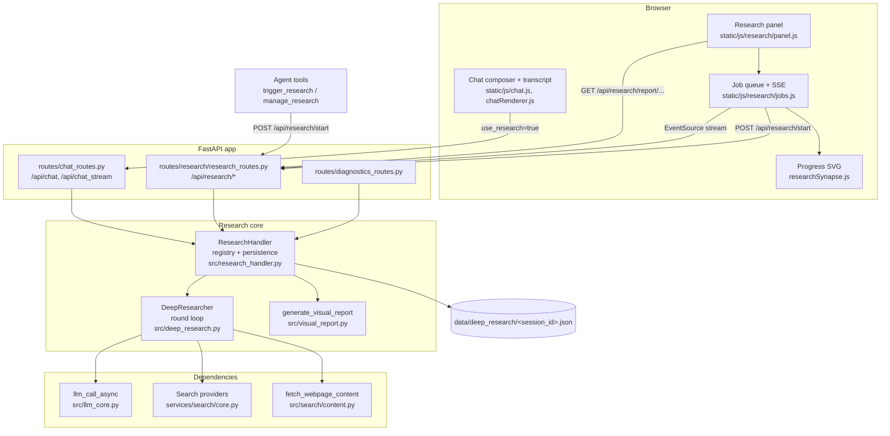
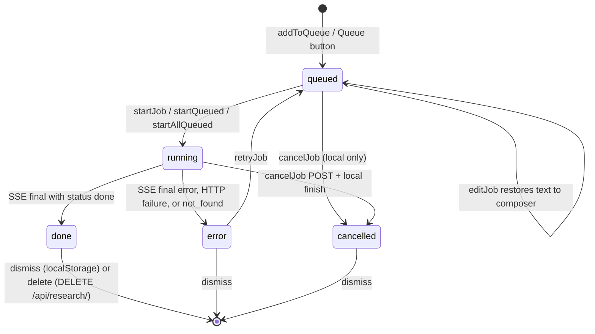
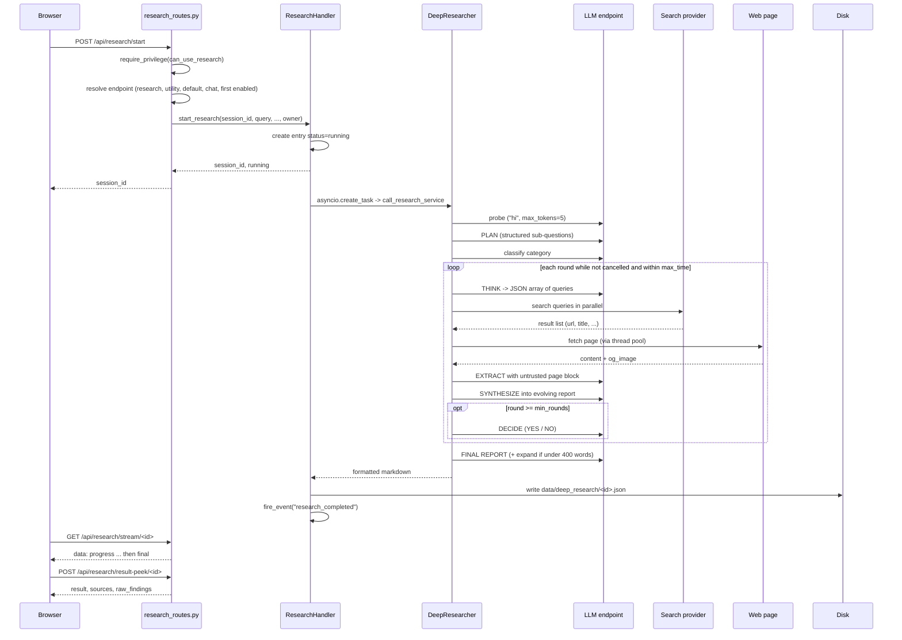
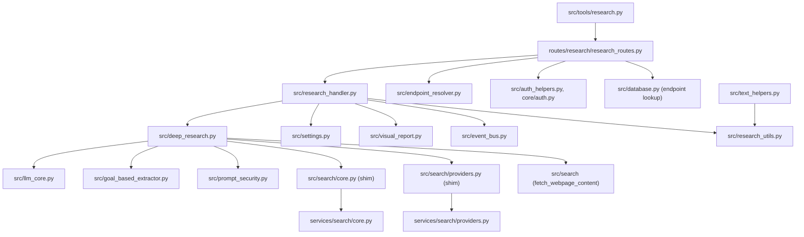

# Deep Research

Deep Research is Zephyrus's multi-round, LLM-in-the-loop web research subsystem. You give it a
question; it plans a strategy, generates its own search queries, fetches and extracts evidence from
web pages, rewrites an evolving report each round, decides when to stop, then writes a long final
report with inline citations. The result is stored on disk, rendered as a full HTML "visual report",
and listed in a searchable Library.

**Implementation status: IMPLEMENTED.** The full pipeline — planning, query generation, search,
extraction, synthesis, stop decision, final report, persistence, visual report, library, cancellation
and two front-end entry points — is present in the repository and exercised by an automated test
suite (228 research-related tests pass; see [Testing and Quality Assurance](#testing-and-quality-assurance)).

Everything below is derived from the source. Where a behaviour could not be established from the
code it is marked **UNVERIFIED**.

**Contents**

- Read first — [Terminology](#terminology), [Key Capabilities](#key-capabilities)
- Understand — [Architecture](#architecture), [User Flow](#user-flow), [Internal Execution Lifecycle](#internal-execution-lifecycle), [Component Breakdown](#component-breakdown)
- Reference — [Data Flow and Data Structures](#data-flow-and-data-structures), [Prompt Contracts](#prompt-contracts), [Configuration Reference](#configuration-reference), [Integrations and Dependencies](#integrations-and-dependencies)
- Operate — [Error Handling and Recovery](#error-handling-and-recovery), [Security and Reliability](#security-and-reliability), [Data Retention and Privacy](#data-retention-and-privacy), [Performance and Limitations](#performance-and-limitations), [Operator Runbook](#operator-runbook), [Troubleshooting and FAQ](#troubleshooting-and-faq)
- Change — [Drift Checks](#drift-checks), [Developer Reference](#developer-reference)
- Verify — [Testing and Quality Assurance](#testing-and-quality-assurance), [Appendix: Verified Source References](#appendix-verified-source-references), [Appendix B: Documentation Audit Report](#appendix-b-documentation-audit-report)

### Using this file on a docs site

This page is deliberately framework-neutral so it can be dropped into any documentation host.

| Concern | Status here | What a host needs |
| --- | --- | --- |
| Front matter | Only `title`, `description`, `status`, `audience`, `last_verified_against` | Any host ignores unknown keys. Docusaurus/VitePress/Nextra read `title`+`description` natively; MkDocs ignores YAML front matter unless a plugin reads it |
| Format | MDX-safe Markdown — no JSX, no imports, no components | Renders identically as `.md` or `.mdx`; verified by the scan in [Testing and Quality Assurance](#testing-and-quality-assurance) |
| Angle brackets and braces | Every `<`, `>`, `{`, `}` in prose sits inside a code span or fenced block | Nothing to do. This is what stops MDX treating a route path as a JSX tag |
| Mermaid diagrams | Five fenced `mermaid` blocks | The host needs a Mermaid renderer (a plugin in most frameworks; on by default almost nowhere). Without one they degrade to readable code blocks, which is why each diagram is also described in the surrounding prose |
| Internal links | Relative `./setup.md`, `../README.md` style for repo docs; `#anchor` for this page | Rewrite relative paths to URLs if your host maps repo files to routes |
| Navigation | None — no sidebar or nav entry is added | Register the page in your site's own sidebar config |
| Length | One long page | If the host paginates by heading, the H2s are already clean split points |

### Terminology

The code and this page use these words in a specific sense. They are not synonyms.

| Term | Meaning in this subsystem |
| --- | --- |
| **Job** / **run** | One execution of the research loop for one query, identified by a session id. Both words refer to the same thing; "job" is used where the lifecycle is the subject, "run" where the resource budget is |
| **Session id** | The job identifier. `rp-` + 12 hex characters from the panel; the chat session id when started from chat; the task's session id when started by the scheduler |
| **Round** | One pass of think → search → extract → synthesise. Rounds are numbered from 1 |
| **Plan** | The LLM's decomposition of the question into sub-questions, topics and success criteria. Produced once, used by every query-generation call |
| **Query** | A single search string generated by the model for one round |
| **Finding** | One extracted source: `rational`, `evidence`, `summary` plus the URL, title and `og_image`. Findings are the unit of evidence |
| **Source** | A finding reduced to `{url, title, image?}` for display. Sources are deduplicated by URL and low-quality filtered |
| **Evolving report** | The report rewritten after every round by the synthesis step. It is what the stop decision reads and what the final report improves on |
| **Category** | The auto-detected output shape: `product`, `comparison`, `howto` or `factcheck`. Adds a format override to the final-report prompt |
| **Phase** | The progress label a run is currently in: `probing`, `planning`, `searching`, `reading`, `analyzing`, `writing`, or the two out-of-band `warning`/`error` |
| **Synapse** | The SVG visualisation in the panel showing the query as a root node, rounds as spokes and sources as leaves. Cosmetic; no data dependency |
| **Consumed** | A persisted report that has been read through `POST /api/research/result/{id}` at least once. Consumed reports are hidden from `get_status`/`get_result` but not deleted |

## Overview

### What it is

A research *job* is a background asyncio task owned by a user, identified by a session id, which runs
the loop implemented in `src/deep_research.py` (class `DeepResearcher`). The engine is explicitly
modelled on Alibaba's IterResearch pattern — the module docstring says so, and the round structure
matches it: **PLAN → THINK → SEARCH → EXTRACT → SYNTHESIZE → DECIDE**.

### What problem it solves

A single web search answers a single question. A question that needs several sub-answers, cross-source
verification, or synthesis ("compare X and Y", "fact-check this claim", "what are the current leading
theories about Z") does not fit in one query. Deep Research turns one question into a multi-round
investigation in which the model — not a fixed pipeline — decides what to search next and when the
evidence is sufficient.

### Role within Zephyrus

Deep Research sits beside Chat, Agent, Cookbook and the shell as one of the top-level tool surfaces.
It has its own modal panel (`#research-overlay`), its own HTTP namespace (`/api/research/*`), its own
on-disk data directory, and its own privilege (`can_use_research`). It is also reachable from three
other places:

1. The **composer's Research toggle** inside a chat session (`#research-toggle`), which streams progress
   into the chat transcript.
2. The **agent tools** `trigger_research` and `manage_research`.
3. The non-streaming `POST /api/chat` endpoint, which runs research inline and injects the report as
   context.

### Intended users

- **End users** who want a researched report rather than a chat answer, and who want to revisit past
  reports in the Library.
- **Developers** extending the engine (new output categories, new search providers, different stopping
  rules) or embedding it in another surface.
- **Operators** tuning depth, timeouts, extraction concurrency and model choice.

### Where the code lives

| Layer | Path |
| --- | --- |
| Research engine (round loop) | `src/deep_research.py` |
| Shared text/quality helpers | `src/research_utils.py` |
| Job registry, persistence, formatting, fallbacks | `src/research_handler.py` |
| HTTP routes | `routes/research/research_routes.py` (canonical) |
| Legacy import shim | `routes/research_routes.py` |
| HTML report generator | `src/visual_report.py` |
| Extraction prompt | `src/goal_based_extractor.py` |
| Agent tools | `src/tools/research.py` |
| Panel UI | `static/js/research/panel.js` |
| Client job queue / state machine | `static/js/research/jobs.js` |
| Progress visualisation (SVG) | `static/js/researchSynapse.js` |
| Standalone service facade | `services/research/service.py`, `services/research/research_handler.py` |

## Key Capabilities

| Capability | Status | Evidence |
| --- | --- | --- |
| Multi-round plan → search → extract → synthesise → decide loop | IMPLEMENTED | `DeepResearcher.research` in `src/deep_research.py` |
| LLM-generated research plan before the first search | IMPLEMENTED | `DeepResearcher._create_plan` |
| Query generation with per-round deduplication | IMPLEMENTED | `DeepResearcher._generate_queries` |
| Provider chain with automatic fallbacks | IMPLEMENTED | `DeepResearcher._search` using `_build_provider_chain` |
| Parallel search + bounded concurrent extraction | IMPLEMENTED | `DeepResearcher._search_and_extract` |
| Boilerplate/low-value extraction filtering | IMPLEMENTED | `is_low_quality` in `src/research_utils.py` |
| Auto-detected report formats (product / comparison / how-to / fact-check) | IMPLEMENTED | `CATEGORY_PROMPTS` + `_classify_category` |
| LLM stop decision after a minimum number of rounds | IMPLEMENTED | `DeepResearcher._should_stop` |
| Retry-with-expansion when the final report is too short | IMPLEMENTED | `DeepResearcher._final_report` |
| Continuation / follow-up research on the same session | IMPLEMENTED | `prior_report`, `prior_findings`, `prior_urls` |
| Background task registry surviving page refresh | IMPLEMENTED | `_active_tasks` in `ResearchHandler` |
| Server-Sent Events progress stream | IMPLEMENTED | `GET /api/research/stream/{session_id}` |
| Cooperative + hard cancellation | IMPLEMENTED | `cancel_research`, `asyncio.wait_for` |
| Partial-result salvage on timeout/error | IMPLEMENTED | `start_research._run` timeout and error branches |
| Per-user result persistence as JSON | IMPLEMENTED | `ResearchHandler._save_result` |
| Self-contained HTML visual report | IMPLEMENTED | `generate_visual_report` in `src/visual_report.py` |
| Library: list, filter, sort, detail, archive, delete | IMPLEMENTED | `routes/research/research_routes.py` |
| "Discuss" spinoff into a new chat session | IMPLEMENTED | `POST /api/research/spinoff/{session_id}` |
| Agent tools (`trigger_research`, `manage_research`) | IMPLEMENTED | `src/tools/research.py` |
| Multi-job queue with parallel or sequential launch | IMPLEMENTED | `startAllQueued`, `startAllQueuedSequential` in `static/js/research/jobs.js` |
| Legacy `ResearchOrchestrator` fallback | PARTIALLY IMPLEMENTED | Branch exists in `_fallback_research`, but `research_engine.py` is **not present** in this checkout, so `_legacy_engine` is always `None` and the branch never executes |
| Basic web-search fallback when the engine dies | IMPLEMENTED | `_handle_research_failure` in `src/research_handler.py` |
| `ResearchService` / `ResearchResult` facade | PARTIALLY IMPLEMENTED | `services/research/service.py` is implemented and unit-tested, but no route or app module instantiates it — it is not reachable from the running web app |
| `deep_research` feature flag | IMPLEMENTED (UI gating only) | `DEFAULT_FEATURES["deep_research"] = False` in `src/settings.py`, served by `GET /api/auth/features`; `static/app.js` hides `#research-toggle-btn`, `#tool-research-btn`, `#overflow-research-btn` and `#rail-research` when it is false. No Python path gates the engine on it — the server-side gate is `can_use_research` |

### Notes on the statuses

- **PARTIALLY IMPLEMENTED — legacy fallback.** `ResearchHandler._initialize_legacy_engine` does
  `from research_engine import ResearchOrchestrator, Config`. There is no `research_engine.py` at the
  repository root, so the import raises `ImportError`, is caught, and logs
  `"Legacy research_engine.py not found — DeepResearcher only"`. The code path is real but dormant.
- **PARTIALLY IMPLEMENTED — `ResearchService`.** It exposes `research()`, `start_background()`,
  `get_status()`, `cancel()` and `_parse_sources()`, and delegates to a *second*, older copy of
  `ResearchHandler` in `services/research/research_handler.py`. Nothing wires it into the app.
  Treat it as a library surface with drift risk, not as the production path.

## Architecture

### Position in the system



The diagram shows only verified call paths. Note that `DeepResearcher` never touches the database and
never writes files: persistence is entirely `ResearchHandler`'s job, and the engine reports progress
purely through a synchronous callback.

### Architectural boundaries

| Boundary | Meaning |
| --- | --- |
| Engine vs handler | `DeepResearcher` knows nothing about HTTP, users, files or sessions. It is given an LLM endpoint and a `progress_callback`, and returns a markdown string. |
| Handler vs routes | `ResearchHandler` owns the in-memory task registry and on-disk JSON. Routes own authentication, ownership checks and request parsing. |
| Server vs client state | The server is authoritative for job status and results. The client keeps a mirror plus a local "dismissed" set in `localStorage`. |
| Per-user isolation | Enforced at the route layer by comparing the `owner` field recorded in memory or in the JSON file. |

### Important design decisions backed by the code

1. **Background task registry instead of request-scoped work.** `start_research` creates an
   `asyncio.Task` and returns immediately with `{"session_id", "status": "running", "query"}`.
   This is what lets a run survive a page refresh — the browser can re-attach with
   `GET /api/research/active` and `GET /api/research/stream/{session_id}`.
2. **Two independent time budgets.** `max_time` is a *cooperative* budget checked between rounds
   inside `DeepResearcher`; `hard_timeout` is an *enforced* `asyncio.wait_for` ceiling around the whole
   run. See [Stopping conditions](#stopping-conditions).
3. **The LLM decides when to stop, but only near the cap.** `_should_stop` is consulted only when
   `round_num >= min_rounds`, and the handler sets `min_rounds = max(2, max_rounds - 2)`.
4. **Fail open with partial results.** Every heavy step (plan, query generation, synthesis, final
   report) catches its own exception and degrades; a timeout or crash with an evolving report present
   is converted into a completed job with a partial report rather than an error.
5. **Untrusted web content is framed as data.** Fetched page text is passed to the extraction LLM via
   `untrusted_context_message("webpage", content)` from `src/prompt_security.py`, never as a system
   message and never concatenated into the trusted prompt.

## User Flow

### Entry point 1 — the Deep Research panel

1. **Discover.** The feature is reachable from the icon rail button `#rail-research` ("Deep Research")
   and the sidebar item `#tool-research-btn`. Both are hidden when the user lacks `can_use_research`
   (`static/js/init.js`).
2. **Open.** Either control opens a modal overlay `#research-overlay` containing `#research-pane`.
   Desktop sizing is `min(640px, 92vw)` with `max-height: 85vh`; at `window.innerWidth` of 768 or less
   it becomes a full-width sheet at `90dvh`. The overlay is created on demand and removed on close
   (`openPanel` / `closePanel` in `static/js/research/panel.js`).
3. **Compose.** The textarea `#research-query` takes the question. Its placeholder cycles through a
   random hint from `_RESEARCH_HINTS` on each render.
4. **Options** (behind the collapsible "Settings" row, `#research-settings-toggle`):

   | Control | Element | Options / default |
   | --- | --- | --- |
   | Rounds | `#research-rounds` | `Auto` (value `0`, default) plus `1`–`20` |
   | Format | `#research-category` | `Auto` (value empty), `product`, `comparison`, `howto`, `factcheck` |
   | Search engine | `#research-search-provider` | `Default` (empty), `searxng`, `duckduckgo`, `tavily`, `brave`, `google`, `serper` |
   | Endpoint | `#research-endpoint` | populated from `GET /api/model-endpoints`, filtered to `is_enabled && model_type === 'llm'` |
   | Model | `#research-model` | populated per selected endpoint |

5. **Submit.** `Start` (`#research-start-btn`) or `Ctrl/Cmd+Enter` in the textarea. `Queue`
   (`#research-add-btn`) stages a job without launching it.
6. **Batch mode.** If more than one job is queued when Start is pressed, `_promptParallelOrSequential`
   asks whether to launch them in parallel (`startAllQueued`) or one at a time
   (`startAllQueuedSequential`).
7. **Feedback while running.** The job card shows the elapsed timer, the current phase text, a
   progress bar (based on `round / (max_rounds || 8)`, capped at 100%), and a live SVG "synapse"
   visualisation. The sidebar entry gains a pulsing dot and a round badge such as `R3`
   (`_syncResearchRail`).
8. **Completion.** The card exposes **Visual Report** (opens
   `GET /api/research/report/<id>` in a new tab), **Discuss** (spinoff into a new chat),
   **Copy** (report plus raw findings to the clipboard), **Clear** (hide from this list,
   persisted in `localStorage`) and **Delete** (remove the JSON from disk).
9. **Follow-up.** To continue a finished investigation, re-open it, set the Rounds/Format you want, and
   start a new job from the same query — the *chat* path performs true continuation (see below); the
   panel path starts an independent job.

Keyboard and window behaviour: `Escape` closes the panel (document-level listener, because the overlay
never receives focus), and the header is draggable via `makeWindowDraggable`.

### Entry point 2 — the chat composer (dormant UI)

The inline "deep research mode" control was **removed from the composer**. `static/index.html` keeps
the `#research-toggle` checkbox inert, with a comment stating it is retained only so existing JS
references do not break, and that "without this entry point it can't be enabled". The paired indicator
button `#research-toggle-btn` is `display:none` until something sets it.

The *plumbing* is intact and still works if something drives it:

- `static/js/chat.js` reads `#research-toggle` and, when checked, appends `use_research=true` to the
  chat form data and forces `mode=chat` even if Agent mode was selected.
- `/toggle research on|off` (`_cmdToggleResearch` in `static/js/slashCommands.js`) still flips that
  checkbox and the indicator.
- The agent can start a job without the checkbox at all (see entry point 3).

So: **the server-side capability is IMPLEMENTED; the user-facing switch is DEPRECATED in favour of
the panel.** Treat this path as reachable via the slash command and the agent, not via a visible
control.

On `POST /api/chat_stream`:

1. If this is the **first** research turn (`no prior research JSON`, history length of 2 or less, and
   not compare mode), the server does **not** start research. It sets the session mode to
   `research_pending` and instructs the model to ask 2–3 brief clarifying questions
   (`_is_first_research` in `routes/chat_routes.py`).
2. On the next message, `synthesize_query` turns the conversation into one focused research query. A
   bare affirmation (`yes`, `ok`, `go ahead`, …) is explicitly *not* treated as a topic: the fallback
   picks the earliest substantive user message instead (`_AFFIRMATIONS`, `_fallback`).
3. `start_research` launches the job, and the stream then polls `get_status` once per second and
   emits `research_progress` events plus SSE comment heartbeats.
4. When the job leaves `running`, the stream emits `research_sources`, `research_findings` and
   `research_done`, then `[DONE]`, and marks the result consumed.
5. On completion the `on_complete` callback writes the report into the session history as an assistant
   message with `metadata.research = true`, `metadata.research_sources` and
   `metadata.research_findings` — so it survives a reload. Incognito sessions skip this.

The transcript renders that message with a "Research sources" collapsible box and a findings box
(`static/js/chatRenderer.js`), plus a footer offering **View full report** and a hint to activate
Research again for a follow-up.

### Entry point 3 — the agent

The agent loop is instructed (in `src/agent_loop.py`) that "research X", "look into Y" and
"deep dive on Z" mean `trigger_research`, *not* `web_search`. `trigger_research`
(`src/tools/research.py`) POSTs to `/api/research/start` with the user's owner headers and returns a
clickable anchor `[topic](#research-<id>)` plus `ui_event: "research_started"`. The frontend adopts
the new session immediately via `adoptSession`, or within 20 seconds via the active-sessions poll.

`manage_research` is the read side: `action: list` (most recent first, filtered by an optional
`search` substring), `action: read` (aliases `open`, `view`, `get`) and `action: delete`.

### Entry point 4 — inline (non-streaming) research

`POST /api/chat` (the JSON rather than SSE endpoint) takes a different path: if `use_research` is set
and tool policy allows it, it awaits `call_research_service` **inline**, wraps the produced report in
`untrusted_context_message("research context", …)` and inserts it into the prompt before calling the
chat model. In this mode there is no job card, no SSE progress, no clarification round, and no
persistence beyond whatever the chat model writes.

### Entry point 5 — scheduled research tasks

The task scheduler can run research unattended. `routes/task_routes.py` accepts
`task_type` values `"llm" | "action" | "research"`; a research task requires a non-empty prompt
(`400 "Prompt is required for LLM/research tasks"`).

`TaskScheduler._execute_research_task` (`src/task_scheduler.py`) resolves the endpoint through
`resolve_endpoint("research", …, owner=task.owner)` and then `_resolve_defaults`, raising
`RuntimeError("No model/endpoint configured for research")` if neither yields anything. It then
constructs `DeepResearcher` **directly** — not through `ResearchHandler` — with `max_rounds=8` and
`max_time=600`, reads `research_max_tokens`, `research_extraction_timeout_seconds` and
`research_extraction_concurrency` from settings, and runs the engine without an
`asyncio.wait_for` ceiling.

On success it writes a JSON file into the same `data/deep_research/` directory in the panel's shape,
with `category: "scheduled"` plus `task_id` and `task_name`, then fires `research_completed`. Because
the file lands in the same directory, scheduled reports appear in the Library and open in the visual
report route like any panel run. Task run statuses come from the scheduler's own vocabulary —
`queued` → `running` → `success` / `error` / `skipped` / `aborted` — not the research handler's.

Two properties follow: scheduled research is **not cancellable** through `/api/research/cancel`
(that route only knows the handler's registry), and it **does not** go through the endpoint probe or
the legacy fallback chain.

### Client state machine



Job ids are `pending-<n>` until the server returns a real `session_id`, at which point the client
reassigns `job.id`. Progress arrives over `EventSource` on
`/api/research/stream/<id>`; if the stream errors while the job is still running, the client falls back
to polling `/api/research/status/<id>` every 2 seconds (`_pollFallback`).

## Internal Execution Lifecycle

### End-to-end sequence



### Stage by stage

**1. Admission.** `POST /api/research/start` calls `require_privilege(request, "can_use_research")`.
The internal tool user (`INTERNAL_TOOL_USER`) is special-cased: the real owner is read from the
`X-Zephyrus-Owner` header and that account's `can_use_research` privilege is re-checked, so the agent
cannot escalate past the human's permissions.

**2. Endpoint resolution.** With an explicit `endpoint_id`, the owner's enabled endpoint is looked up
and 404s if it is not visible to the caller. Otherwise the chain is
`research` → `utility` → `default` → `chat` → the caller's first enabled endpoint, ending in
`400 "No endpoints configured. Add one in Settings first."` A caller-supplied `model` overrides the
resolved model.

**3. Job registration.** `start_research` validates the session id against
`^[A-Za-z0-9-]{1,128}$`, cancels any running job with the same id, releases finished entries past the
one-hour TTL, and creates the registry entry with `status: "running"`. The id format differs by origin:
the panel generates `rp-` plus 12 hex characters; chat reuses the chat session id.

**4. Probing.** Before the expensive work, `_probe_endpoint` issues a one-token-ish
`"hi"` completion with a 15-second timeout. A failure is turned into a user-facing message by
`_format_probe_failure` — for example `Model '<name>' requires an API key. Check your endpoint configuration.` — and is raised as a `RuntimeError` from inside the guarded block, so the fallback chain still runs.

**5. Planning.** `_create_plan` asks for a JSON object with `sub_questions`, `key_topics` and
`success_criteria`. It is flattened into a plain-text plan that is later injected into every
query-generation prompt. A failure emits a `warning` phase ("Planning step failed, proceeding with
direct search") and the run continues with an empty plan.

**6. Category classification.** `_classify_category` makes a 20-token, temperature-0 call asking for
exactly one of `product`, `comparison`, `howto`, `factcheck`. It first accepts a clean single-word
answer, then scans the whole reply for any known label (tolerating "the category is product"), and
returns `None` for "general". Classification is skipped for continuation runs.

**7. The round loop.** Each iteration emits `searching`, generates queries, runs
`_search_and_extract`, emits `reading` and/or `analyzing`, synthesises, then optionally asks the model
whether to stop.

**8. Search.** `_search` picks a provider: the explicit request override, then the
`research_search_provider` setting, then `search_provider` (default `searxng`). `disabled` short-circuits
to an empty list. Otherwise it walks `_build_provider_chain(provider)` — primary first, then the
configured `search_fallback_chain` (or the built-in fallback order) — calling each through
`asyncio.to_thread`. A provider that returns results is recorded in `providers_used` and wins. If every
provider ran without raising but returned nothing, `_last_search_error` is set to
`no results from search provider(s): <chain>` so the eventual error is actionable rather than
"unknown error".

**9. Extraction.** Each newly seen URL is fetched with `fetch_webpage_content(url, 10)` in a thread,
truncated to `max_content_chars` (preferring a paragraph boundary when the nearest double newline is
past 80% of the cap), then sent to the model with `EXTRACTOR_SYSTEM.format(goal=question)` as the
first user message and the page body as a separate guarded user message. The expected reply is a JSON
object with `rational`, `evidence` and `summary`. The engine stamps `url`, `title` and `og_image` onto
it, then drops the finding when `is_low_quality(summary)` matches a boilerplate marker. If parsing
fails, the raw response is kept instead: first 3000 characters as `evidence`, first 500 as `summary`.
Concurrency is bounded by an `asyncio.Semaphore` sized from `extraction_concurrency`, deliberately to
avoid flooding a single-GPU local model server.

**10. Synthesis.** `_synthesize` passes the *last* `synthesis_window` findings (default 10) plus the
current report into `SYNTHESIZE_PROMPT` and asks for a rewritten report. The call uses a hard-coded
180-second timeout and `max_report_tokens`. On failure it logs, emits `warning` ("Synthesis failed,
keeping previous report") and returns the previous report unchanged.

**11. Decision.** `_should_stop` asks a 128-token temperature-0.1 question and looks for a leading
`YES` after stripping thinking blocks and leading punctuation (`**YES**`, `Yes.`, quotes). Any
exception returns `False`, i.e. continue.

**12. Final report.** `_final_report` asks for at least 1500 words with headings, a summary, inline
`[text](url)` citations and a conclusion, then appends the category-specific format override. If the
result is under **400 words**, it makes one expansion call (temperature 0.4, 180 seconds) and keeps the
expansion only if it is longer. Any exception returns the evolving report as the final answer.

**13. Formatting and persistence.** `call_research_service` records `raw_report` and `stats` on the
registry entry and returns `_format_research_report`'s output: a `## Research Summary` block with
Duration, Rounds, Queries and URLs Analyzed, followed by the report body. On success the handler sets
`status = "done"`, writes the JSON file, and invokes the `on_complete` callback with
`(session_id, result, sources, findings)`.

### Stopping conditions

The loop can end for six distinct reasons. Understanding the interplay is essential when tuning.

| Trigger | Where | Effect |
| --- | --- | --- |
| `_cancelled` flag set | top of each round | break; run finishes with whatever report exists |
| `max_time` exceeded | `_time_exceeded()` at top of each round | break; **cooperative** budget, checked only between rounds |
| No queries generated | after `_generate_queries` | break |
| `max_empty_rounds` consecutive empty rounds (default 2) | after extraction | if nothing has ever been found, return an explicit "Search unavailable" report; otherwise break |
| LLM says YES | `_should_stop`, only when `round_num >= min_rounds` | normal early stop |
| `max_rounds` reached | `range(1, max_rounds + 1)` | loop exits after the final round |

Two consequences worth stating plainly:

- **`min_rounds` can be high.** `call_research_service` sets `min_rounds = max(2, max_rounds - 2)`. With
  the default `max_rounds = 20`, the stop question is first asked at **round 18**. With a panel choice of
  `8`, it is first asked at round 6. The practical limiter for most runs is therefore `max_time`
  (default 300 seconds), not the round count.
- **The hard timeout is a separate, larger number.** `research_run_timeout_seconds` (default `1800`)
  wraps the whole run in `asyncio.wait_for`. Setting it to `0` disables the ceiling entirely.

### Continuation runs

When chat starts research and a JSON file already exists for that session, the handler loads
`raw_report`, `raw_findings` and the set of already-visited source URLs, and passes them as
`prior_report`, `prior_findings` and `prior_urls`. Inside the engine this means:

- prior findings seed the findings list, so synthesis has history immediately;
- prior URLs are added to `urls_fetched`, so the search step will not re-fetch them;
- planning still runs (the branches for first-run and continuation both call `_create_plan`);
- category classification is skipped.

### Timeouts and budgets at a glance

| Budget | Default | Set by | Enforced? |
| --- | --- | --- | --- |
| `max_time` (cooperative round budget) | 300 s | request `max_time` (60–1800) | No — checked between rounds only |
| Hard wall clock | 1800 s | setting `research_run_timeout_seconds` (0 disables; else 60–86400) | Yes — `asyncio.wait_for` |
| Planning call | 90 s | setting `research_planning_timeout_seconds` | Yes — per LLM call |
| Query generation call | 90 s | setting `research_query_timeout_seconds` | Yes — per LLM call |
| Extraction call | 90 s | setting `research_extraction_timeout_seconds` (or request) | Yes — per LLM call |
| Synthesis call | 180 s | hard-coded | Yes — per LLM call |
| Final report call | 180 s | hard-coded | Yes — per LLM call |
| Stop decision call | 60 s | `_llm` default | Yes — per LLM call |
| Endpoint probe | 15 s | hard-coded | Yes |
| Category classification | 15 s | hard-coded | Yes |

## Component Breakdown

### `DeepResearcher` — `src/deep_research.py`

| Field | Detail |
| --- | --- |
| Purpose | The research loop itself |
| Responsibilities | Plan, classify, generate queries, search, extract, synthesise, decide, write the final report, emit progress |
| Inputs | `llm_endpoint`, `llm_model`, `llm_headers`, plus tuning parameters (see the table below) and an optional `progress_callback` |
| Outputs | `research()` returns the final markdown report (a `str`); `get_stats()` returns a stats dict; `findings`, `urls_fetched`, `analyzed_urls`, `providers_used`, `evolving_report` are readable afterwards |
| Dependencies | `src.llm_core.llm_call_async`, search providers, `fetch_webpage_content`, `src.prompt_security`, `src.research_utils` |
| Key methods | `research`, `cancel`, `_create_plan`, `_classify_category`, `_generate_queries`, `_search_and_extract`, `_search`, `_fetch_and_extract`, `_synthesize`, `_should_stop`, `_final_report`, `_parse_json_array`, `_parse_json_object`, `get_stats` |
| Error handling | Each stage catches locally and degrades; the public entry point never raises for a partial failure |

Constructor defaults (as declared, before the handler overrides some of them):

| Parameter | Default | Range enforcement |
| --- | --- | --- |
| `max_rounds` | 8 | none |
| `max_time` | 300 | none |
| `max_urls_per_round` | 3 | none |
| `max_content_chars` | 15000 | none |
| `max_report_tokens` | 8192 | none |
| `extraction_timeout` | 90 | clamped to 15–3600 |
| `planning_timeout` | 90 | clamped to 15–3600 |
| `query_timeout` | 120 | clamped to 15–3600 |
| `extraction_concurrency` | 3 | clamped to 1–12 |
| `min_rounds` | 2 | none |
| `max_empty_rounds` | 2 | none |
| `synthesis_window` | 10 | none |

Note that `call_research_service` does **not** pass `max_urls_per_round`, `max_content_chars`,
`max_empty_rounds` or `synthesis_window`, so those four always take the engine defaults above in
production.

### `ResearchHandler` — `src/research_handler.py`

| Field | Detail |
| --- | --- |
| Purpose | Own the lifecycle: registry, persistence, cancellation, formatting, fallbacks |
| Responsibilities | Start/cancel background tasks; store the researcher reference; write and read JSON; expose sources and raw findings; generate the HTML report; hide images; compute average duration |
| Inputs | `start_research(session_id, query, llm_endpoint, llm_model, max_time, hard_timeout, llm_headers, on_complete, prior_*, max_rounds, search_provider, category, extraction_timeout, extraction_concurrency, owner)` |
| Outputs | `start_research` returns `{"session_id", "status", "query"}`; `get_status` returns a dict; `get_result` returns a string; `get_sources` / `get_raw_findings` return lists |
| Dependencies | `src.deep_research`, `src.constants.DEEP_RESEARCH_DIR`, `src.settings`, `src.event_bus`, `src.visual_report`, `src.search` |
| Error handling | Timeout, cancellation and generic exceptions each have a branch; the callback is guarded against double invocation by `_guarded_complete` |

A single module-level instance is created in `src/app_initializer.py` and stored on
`app.state.research_handler`; all routes and the chat stream share it.

### `research_routes` — `routes/research/research_routes.py`

| Field | Detail |
| --- | --- |
| Purpose | HTTP surface and access control |
| Responsibilities | Authentication, privilege checks, owner scoping, request validation, SSE delivery, endpoint resolution, spinoff session creation |
| Inputs | Query parameters, `ResearchStartRequest` for start, `HideImageRequest` for image hiding |
| Outputs | JSON dicts, an SSE `StreamingResponse`, and `HTMLResponse` for the visual report |
| Error handling | `HTTPException` with 400/401/404/500 as appropriate |

The module at `routes/research_routes.py` is a compatibility shim: it imports the canonical module and
replaces itself in `sys.modules`, so legacy import paths and string-targeted `monkeypatch.setattr`
calls resolve to the same object.

All routes are registered by `setup_research_routes(research_handler, session_manager=None)` on an
`APIRouter(tags=["research"])`. Nothing uses `Depends(...)`; auth is checked imperatively inside each
handler.

| Method | Path | Purpose | Gate |
| --- | --- | --- | --- |
| GET | `/api/research/active` | Running jobs owned by the caller | `_require_user` + owner filter |
| GET | `/api/research/status/{id}` | Status, progress, query, `avg_duration` | `_require_user` + `_owns_in_memory` |
| POST | `/api/research/cancel/{id}` | Set the cancel flag and cancel the task | `_require_user` + `_owns_in_memory` |
| POST | `/api/research/result/{id}` | Fetch result, sources, findings; **marks consumed** | `_require_user` + `_owns_in_memory` |
| POST | `/api/research/result-peek/{id}` | Same payload, **does not** consume | `_require_user` + owned-or-active |
| GET | `/api/research/stream/{id}` | SSE progress stream | `_require_user` + `_owns_in_memory` |
| GET | `/api/research/report/{id}` | Standalone HTML visual report | `_require_user` + `_assert_owns_research` |
| POST | `/api/research/{id}/hide-image` | Add a URL to `hidden_images` | `_require_user` + `_assert_owns_research` |
| POST | `/api/research/{id}/unhide-images` | Clear `hidden_images` | `_require_user` + `_assert_owns_research` |
| GET | `/api/research/library` | List, filter, sort, limit saved reports | `_require_user` + owner filter |
| GET | `/api/research/detail/{id}` | Raw persisted JSON | `_require_user` + inline owner check |
| POST | `/api/research/{id}/archive` | Toggle the `archived` flag | `_require_user` + inline owner check |
| DELETE | `/api/research/{id}` | Delete the JSON file | `_require_user` + inline owner check |
| POST | `/api/research/start` | Start a background job | `require_privilege("can_use_research")` |
| POST | `/api/research/spinoff/{id}` | Create a follow-up chat session seeded with the report | `_require_user` + owned-or-active |

`ResearchStartRequest` (the `/start` body) is the whole public tuning surface:

| Field | Type | Default | Bound |
| --- | --- | --- | --- |
| `query` | string | required | — |
| `max_rounds` | int | `0` (meaning 20) | 0–20 |
| `search_provider` | string or null | `None` | — |
| `endpoint_id` | string or null | `None` | must resolve for the caller |
| `model` | string or null | `None` | — |
| `max_time` | int | `300` | 60–1800 |
| `extraction_timeout` | int or null | `None` (→ setting) | 15–3600 |
| `extraction_concurrency` | int or null | `None` (→ setting) | 1–12 |
| `category` | string or null | `None` | any string |

Adjacent endpoints outside this module that are part of the feature:

| Method | Path | Notes |
| --- | --- | --- |
| POST | `/api/chat_stream` | Research-from-chat path; form-encoded, multiplexes research events into the SSE stream |
| POST | `/api/chat` | Inline research; awaits `call_research_service` and injects the report as context |
| POST | `/api/test-research` | Admin-only smoke test; hard-codes an endpoint URL and model, returns `{"status", "result_preview", "result_length"}` or `{"status": "error", "error"}` with HTTP 200 |
| GET | `/api/tasks/runs/recent` | Exposes `research_id` for scheduled research runs |

### `generate_visual_report` — `src/visual_report.py`

Builds a self-contained HTML document from the stored report. Verified behaviours:

- Uses the report's first heading as the page title, falling back to the query (`_extract_report_title`).
- Promotes bold-only lines to `##` headings when the report has no `##`/`###` headings at all.
- Converts markdown to HTML, extracts headings and applies anchor ids, then builds a table of contents.
- Collects `https` images from sources, rejects `.svg`/`.ico`/`.gif`, an explicit blocklist entry and
  icon/logo-looking URLs, uses the first as a hero image, injects the rest between sections, and keeps
  the remainder as a "spare pool" for in-page rerolling.
- Renders a stats bar from `Duration`, `Rounds`, `Queries`, `URLs`, `Model`, `Search`.
- Renders a collapsible Sources panel with per-domain labels.
- Adds a "Discuss" call-to-action only when a session id is present, and a "Restore hidden images" button
  (id `btn-restore-images`, title `Restore N hidden image(s)`) only when a session id **and** at least
  one hidden image are both present, because the button needs the session id to call the endpoint.
- Applies category-specific CSS (`_category_css`), plus a quick-links bar of `###` headings for
  `product` reports.

### Front-end modules

| Module | Responsibility |
| --- | --- |
| `static/js/research/panel.js` | Panel construction, settings persistence, endpoint/model loading, job rendering, synapse lifecycle, copy/report/discuss actions, rail badge sync, orbit animation |
| `static/js/research/jobs.js` | Job array, launch, SSE connection, polling fallback, cancel/retry/remove, library sync, phase label formatting |
| `static/js/researchSynapse.js` | SVG visualisation of the research tree: root query node, sub-query spokes, leaf source nodes, per-phase label, timer |

`jobs.js` exports `init`, `adoptSession`, `refreshLibrary`, `setRenderCallback`, `getJobs`,
`addToQueue`, `startJob`, `startQueued`, `startAllQueued`, `startAllQueuedSequential`, `retryJob`,
`cancelJob`, `removeJob`, `clearAll`, `formatElapsed`, `formatPhase`, `onComplete`.

#### The panel is built at runtime

Nothing in `static/index.html` defines the research overlay. `panel.js` creates it on first open: the
outer `#research-overlay` (`class="modal research-overlay"`) is appended to the document body, and
`#research-pane` is filled from `_buildPanelHTML()`. Consequences worth knowing before debugging it:

- The DOM nodes other modules query (`#research-query`, `#research-rounds`, `#research-jobs-list`, all of
  them) do not exist until the panel has been opened once.
- Sizing is decided at construction time from `window.innerWidth`. At 768 px or narrower the pane is
  `100vw` wide and `90dvh` tall with `14px 14px 0 0` corners, anchored to the bottom by the stylesheet;
  above that it is `min(640px, 92vw)` capped at `85vh`. Resizing the window does not re-run that choice.
- The backdrop click closes the panel, and an `Escape` listener is attached to `document` because a
  listener on the overlay never fired (the overlay is not focused).
- The header is a drag handle through `makeWindowDraggable`.
- Focus moves to the textarea on open. There is no focus trap and no `role="dialog"` or `aria-modal` on
  the generated overlay; the only ARIA attribute the panel emits is `aria-hidden` on empty thumbnails.

#### Browser state it owns

| Key | Contents | Written by | Read when |
| --- | --- | --- | --- |
| `zephyrus-research-settings` | JSON: `max_rounds`, `search_provider`, `endpoint_id`, `model`, `category` | `_saveSettingsToStorage` | `_restoreSavedSettings` on open |
| `zephyrus-research-settings-collapsed` | `"1"` or `"0"` | Panel settings toggle | Module load |
| `zephyrus-research-dismissed` | JSON array of dismissed job ids | `jobs.js` dismiss path | Module load and each render |
| `research.synapseMinimized` | `"1"` or `"0"` | `_toggleSynapseMinimized` | Module load |

Rounds are saved but deliberately not restored: `_restoreSavedSettings` skips it with a comment saying
the cap should default to Auto on every open. Everything else in that object is restored, so a user who
picks a provider and a model keeps both.

#### Command and key surface

| Surface | Trigger | Resolves to |
| --- | --- | --- |
| Rail | `#rail-research` | Panel open |
| Chat toolbar | `#tool-research-btn` | Panel open, plus the running badge |
| Keybinding | `open_research` | **Unbound by default** (`''` in `keyboard-shortcuts.js` and in the `settings.js` defaults); the user must bind it |
| Slash | `/research` | `_cmdToolPanel('research', ...)`, which opens the panel |
| Slash | `/toggle research` (alias `/toggle r`) | `_cmdToggleResearch`, which flips `#research-toggle`, the inert checkbox left over from the removed composer control |
| Slash | `/tour-research` (alias `/research-tour`) | `_cmdTourResearch`, a guided overlay tour |

`LEGACY_ALIASES` also maps a flat `research` to `toggle research`, but the live `/research` command is
resolved first, so the panel opens and the alias never shadows it.

#### Refresh cadences

Four independent timers mean the screen can lag the server briefly. None of them is a bug on its own.

| Interval | Where | What it does |
| --- | --- | --- |
| 1.5 s | SSE generator, `research_routes.py` | Re-reads status and writes a frame only when the payload changed |
| 3 s | `es.onerror` in `jobs.js` | First fallback poll after the stream drops |
| 2 s | `_pollFallback` | Subsequent `/status` polls until the run ends |
| 20 s | `_reconnectActive` interval | Reattaches to runs that were already in flight when the page loaded |
| 120 s | `_LIBRARY_SYNC_MIN_MS` | Minimum spacing between Library refreshes |

Verified absences in the panel, stated so they are not assumed:

- **No inline report body.** `_buildJobCard` contains a branch that would render
  `_renderResult(job)` when `_expandedJobId === job.id`, but `_expandedJobId` is declared and only
  ever *read* — nothing assigns it and there is no expand control. The report is only reachable
  through the visual report route or the chat transcript.
- **No "save to notes" action.** The export paths are clipboard copy and the visual report's
  `Save as PDF` / `Download HTML` toolbar.
- **No time-limit control.** There is no `max_time` input in the panel; `/api/research/start` always
  uses its default of 300 seconds. The wall-clock cap is the global
  `research_run_timeout_seconds` setting.
- **No URL-per-round or source-count control.** Those are engine constants.
- **No charts or diagrams in the visual report.** It is prose, tables, a TOC and source images.
- **No URL route for the panel.** It is a modal; `#research-<id>` hash links are focus links only.
- **The `landscape` category is unreachable from the UI.** It has an icon, a label and CSS in
  `panel.js`/`style.css` and the server accepts any category string, but the `#research-category`
  select offers only Auto, Product, Compare, How-to and Fact-check.

## Data Flow and Data Structures

### The finding

One extracted source. Built in `DeepResearcher._fetch_and_extract`:

| Field | Type | Source |
| --- | --- | --- |
| `rational` | string | LLM extraction |
| `evidence` | string | LLM extraction (verbatim context) |
| `summary` | string | LLM extraction (the field `is_low_quality` inspects) |
| `url` | string | search result / fetch target |
| `title` | string | search result title, page title, or the URL |
| `og_image` | string | page metadata, may be empty |

Fallback shape when JSON parsing fails: `url`, `title`, `og_image`, `rational` set to
`"LLM extraction (raw)"`, `evidence` as the first 3000 characters and `summary` as the first 500.

### The progress event

Emitted by `_emit` and delivered as the SSE payload. Fields are sparse — each phase fills in what it
knows:

| Field | Phases | Meaning |
| --- | --- | --- |
| `phase` | all | `probing`, `planning`, `searching`, `reading`, `analyzing`, `writing`, `warning`, `error` |
| `round` | searching, reading, analyzing | current round number |
| `queries` | searching | how many queries this round |
| `query_preview` | searching | first query as a preview string |
| `url`, `title` | reading | the page currently being read |
| `new_sources` | reading | findings added this round |
| `total_sources` | searching, reading, analyzing, writing | distinct URLs seen so far |
| `total_findings` | reading, analyzing, writing | findings so far |
| `model` | probing | model name |
| `message` | warning, error | human-readable note |

The client maps these to labels in `formatPhase` (`static/js/research/jobs.js`):
`Probing model...`, `Planning research strategy...`, `Round N/M: Searching (Q queries)`,
`Round N/M: Reading S sources`, `Round N/M: Analyzing F findings`, `Writing report -- S sources`.
The `N/M` prefix is emitted only when the job has a `round`; the `/M` half appears only when the
caller passes a round cap. Unknown phases fall through as the raw phase string.

### The persisted record

Written by `ResearchHandler._save_result` to `data/deep_research/<session_id>.json`:

| Field | Type | Notes |
| --- | --- | --- |
| `query` | string | the (possibly synthesised) research question |
| `status` | string | `done` for anything persisted by the success path |
| `result` | string | formatted markdown including the Research Summary header |
| `raw_report` | string | the report body before handler formatting; used by the visual report |
| `sources` | list | `{url, title, optional image}`, deduplicated, low-quality filtered |
| `raw_findings` | list | `{url, title, summary}`, content capped at 2000 characters |
| `stats` | object | `Duration`, `Rounds`, `Queries`, `URLs`, `Model`, optional `Search`, optional `Category` |
| `category` | string or null | `product`, `comparison`, `howto`, `factcheck`, or null |
| `started_at` | float | epoch seconds |
| `completed_at` | float | epoch seconds |
| `owner` | string | authenticated username; the isolation key |
| `archived` | bool | absent until the archive endpoint is used |
| `consumed` | bool | absent until a result has been read once |
| `hidden_images` | list | URLs hidden from the visual report |

`sources` and `raw_findings` are built from the researcher's findings and cached on the entry by
`_save_result`. `_extract_sources` deduplicates by URL and skips low-quality summaries;
`_extract_raw_findings` falls back to `evidence` when `summary` is empty and drops entries with no
content.

### Where state lives

| State | Location | Lifetime |
| --- | --- | --- |
| Running jobs, progress, researcher ref | `ResearchHandler._active_tasks` (process memory) | Until released; terminal entries are dropped after `_FINISHED_ENTRY_TTL_SECONDS` (3600 s) if a JSON file exists |
| Completed results | `data/deep_research/<session_id>.json` | Until deleted via the API |
| Chat-embedded research | Session history with `metadata.research*` | Session lifetime (skipped for incognito) |
| Dismissed panel cards | `localStorage` key `zephyrus-research-dismissed` | Until cleared |
| Panel settings (format, provider, endpoint, model) | `localStorage` | Persisted across opens; Rounds deliberately resets to Auto |
| Panel collapse state | `localStorage` key `zephyrus-research-settings-collapsed` | Persisted |

### Data-flow diagram

```mermaid
flowchart LR
    Q["User question"] --> PLAN["Plan<br/>sub_questions, key_topics"]
    PLAN --> QUERY["Queries<br/>JSON array of strings"]
    QUERY --> SEARCH["Provider chain<br/>results: url + title"]
    SEARCH --> FETCH["fetch_webpage_content<br/>content + og_image"]
    FETCH --> EXTRACT["Extraction LLM<br/>rational / evidence / summary"]
    EXTRACT --> FILTER{"is_low_quality<br/>on summary?"}
    FILTER -->|yes| DROP["discard"]
    FILTER -->|no| FIND["finding"]
    FIND --> SYNTH["Synthesis<br/>window of last 10 findings"]
    SYNTH --> REPORT["Evolving report"]
    REPORT --> STOP{"round >= min_rounds<br/>and LLM says YES?"}
    STOP -->|no| QUERY
    STOP -->|yes| FINAL["Final report LLM<br/>+ expansion if under 400 words"]
    FINAL --> FMT["_format_research_report"]
    FMT --> PERSIST["data/deep_research/&lt;id&gt;.json"]
    PERSIST --> HTML["generate_visual_report"]
```



## Prompt Contracts

Every LLM call in the engine is a single-shot chat completion with a fixed prompt constant. There is
no function calling, no JSON mode flag and no structured-output API — structure is requested in prose
and recovered by the parsers described below. That makes these seven prompts the real interface
between the engine and the model, and the most likely place for a model swap to break behaviour.

All constants live in `src/deep_research.py` except the extractor, which lives in
`src/goal_based_extractor.py`.

| Call site | Constant | Sampling | Output contract | Parser |
| --- | --- | --- | --- | --- |
| Research plan | `RESEARCH_PLAN_PROMPT` | temp 0.3, 1024 tokens, `planning_timeout` | JSON object with `sub_questions` (3–6 strings), `key_topics` (array), `success_criteria` (one sentence) | Lenient: any JSON object in the reply is accepted; on failure the plan is empty and a `warning` phase is emitted |
| Category classification | inline prompt, `_classify_category` | temp 0, 20 tokens, 15 s | Exactly one of `product`, `comparison`, `howto`, `factcheck` | Two-stage: accept a clean single-word answer, else scan the reply for any known label; anything else → `None` (general) |
| Query generation | `QUERY_GEN_PROMPT` | temp 0.5, 4096 tokens, `query_timeout` | JSON array of strings | `_parse_json_array` — must not harvest the prompt's own echoed example array (regression-tested) |
| Page extraction | `EXTRACTOR_SYSTEM` (`src/goal_based_extractor.py`) | temp 0.2, 2048 tokens, `extraction_timeout` | JSON object with `rational`, `evidence`, `summary` | `_parse_json_object`; on failure the raw reply is kept as `evidence` (first 3000 chars) and `summary` (first 500) |
| Synthesis | `SYNTHESIZE_PROMPT` | temp 0.3, `max_report_tokens`, 180 s | Rewritten markdown report, no preamble | Treated as prose; thinking blocks stripped |
| Stop decision | `STOP_PROMPT` | temp 0.1, 128 tokens, 60 s | `YES` or `NO` plus one sentence of reasoning | Leading-token check after stripping thinking blocks and punctuation; any exception → `NO` (continue) |
| Final report | `FINAL_REPORT_PROMPT` | temp 0.3, `max_report_tokens`, 180 s | Markdown, minimum 1500 words, `##`/`###` structure, inline `[text](url)` citations, executive summary, conclusion | Word-count gate: under 400 words triggers one expansion call |
| Report expansion | inline prompt, `_final_report` | temp 0.4, `max_report_tokens`, 180 s | A longer version of the same report | Kept only if longer than the original |

### What the planner is told

`RESEARCH_PLAN_PROMPT` asks for three things — the sub-questions to investigate, the topics and angles
to cover, and a one-sentence definition of a complete answer — and is prefixed with
`current_date_context()`. That prefix exists because a regression (issue #1341) showed the model
defaulting to its training-cutoff year and emitting queries like "best Python tutorials 2025". The
preamble is injected into both the plan call and every query-generation call; it is the only
mechanism keeping generated queries in the present.

### What the query prompt varies per round

Round 1 and later rounds use the same template with different arguments:

| Round | `num_queries` | `round_instruction` |
| --- | --- | --- |
| 1 | 4 | broaden — "generate broad, diverse queries that explore the key facets of the question" |
| 2 and later | 3 | narrow — "targeted follow-up queries to fill gaps, verify claims, or explore specific aspects" |

The prompt also receives the full plan, the current evolving report ("What we know so far") and the
round number, so the model can see what it has already covered.

### What the synthesis prompt guarantees

`SYNTHESIZE_PROMPT` is an integration instruction, not an append instruction: it asks the model to
remove redundancy, resolve contradictions and keep logical flow, and to emit **only** the updated
report. Because the output replaces the previous report wholesale, a bad synthesis loses earlier
prose — which is why the failure path keeps the previous report rather than accepting a partial one.

### What the final report is asked for

`FINAL_REPORT_PROMPT` is the strictest contract in the subsystem: a minimum of 1500 words, `##`
headings with `###` subheadings, multiple paragraphs per section rather than bullet lists, explicit
numbers from the evidence, inline `[text](url)` citations, a note where sources disagree, an
executive summary at the top and a conclusion that answers the question. The category override is
appended after this text, so a `product` report still gets the minimum-length and citation
requirements before its ranked-list format.

### How untrusted page text reaches the model

The extraction call is the only place where attacker-controllable content enters a prompt, and it is
constructed deliberately:

1. The system-role-equivalent instruction is `EXTRACTOR_SYSTEM.format(goal=question)` sent as a **user**
   message — the question is user-authored, so it is not privileged.
2. The page body is sent as a separate user message produced by
   `untrusted_context_message("webpage", content)` from `src/prompt_security.py`, which sanitises the
   label, escapes guard markers and wraps the text in an explicit data block.
3. No page text is ever concatenated into a system message.

The consequence for documentation and support: if a report contains an instruction-looking sentence,
it came from a page and was treated as data, not obeyed as a system instruction by design.

## Configuration Reference

All settings live in `src/settings.py` (`DEFAULT_SETTINGS`) and are persisted in
`data/settings.json`. Values can be changed through Settings or by editing that file.

| Name | Type | Default | Required | Purpose |
| --- | --- | --- | --- | --- |
| `research_endpoint_id` | string | `""` | No | Endpoint used for research; empty means fall through the resolution chain |
| `research_model` | string | `""` | No | Model override for research |
| `research_search_provider` | string | `""` | No | Provider for research searches only; empty falls back to `search_provider` |
| `research_max_tokens` | int | `16384` | No | `max_tokens` for synthesis and final-report calls |
| `research_extraction_timeout_seconds` | int | `90` | No | Per-page extraction call timeout (clamped 15–3600) |
| `research_planning_timeout_seconds` | int | `90` | No | Planning call timeout (clamped 15–3600); defaults to the extraction timeout when unset |
| `research_query_timeout_seconds` | int | `90` | No | Query-generation call timeout (clamped 15–3600); defaults to the extraction timeout when unset |
| `research_extraction_concurrency` | int | `3` | No | Simultaneous page extractions (clamped 1–12) |
| `research_run_timeout_seconds` | int | `1800` | No | Hard wall-clock cap for one run. `0` disables the cap; otherwise clamped 60–86400 |

Search-side settings that change research behaviour:

| Name | Type | Default | Effect on research |
| --- | --- | --- | --- |
| `search_provider` | string | `"searxng"` | Provider when no research-specific provider is set |
| `search_fallback_chain` | list or string | `["duckduckgo"]` | Appended to every provider chain; a comma-separated string is also accepted |
| `search_url` | string | `""` | Base URL for a SearXNG instance |
| `search_result_count` | int | `5` | Used when the caller passes the default count of 10 |
| `search_safesearch` | string | `"strict"` | Passed to providers that support it (SearXNG, Brave, DuckDuckGo, Google PSE, Serper) |

Image and content limits that are **not** settings (engine constants): `max_urls_per_round` 3,
`max_content_chars` 15000, `max_empty_rounds` 2, `synthesis_window` 10.

Environment variables:

| Variable | Relevance |
| --- | --- |
| `ZEPHYRUS_DATA_DIR` | Read once by `src/constants.py`; `DEEP_RESEARCH_DIR` is `DATA_DIR/deep_research`, so this moves where reports are stored |
| `ZEPHYRUS_INTERNAL_BASE` / `APP_PORT` | Consumed by `internal_api_base()`; relevant to the agent tool path that POSTs to the internal API |

Privilege:

| Privilege | Default | Enforced at |
| --- | --- | --- |
| `can_use_research` | `true` (`core/auth.py`) | `/api/research/start`, and the chat paths that set `use_research` |

Example settings fragment (illustrative, not a required shape):

```json
{
  "research_endpoint_id": "ep_local",
  "research_model": "qwen2.5:32b",
  "research_search_provider": "searxng",
  "research_max_tokens": 16384,
  "research_extraction_timeout_seconds": 180,
  "research_extraction_concurrency": 2,
  "research_planning_timeout_seconds": 180,
  "research_query_timeout_seconds": 180,
  "research_run_timeout_seconds": 3600,
  "search_provider": "searxng",
  "search_fallback_chain": ["duckduckgo"]
}
```

## Integrations and Dependencies

| Integration | Role | Mechanism | Configuration | If it fails |
| --- | --- | --- | --- | --- |
| LLM endpoint | Planning, extraction, synthesis, decisions, final report | `llm_call_async` (OpenAI-compatible chat completions) | `research_endpoint_id` / `research_model`, or the resolution chain | Probe failure raises, which triggers the fallback chain; per-call failures degrade locally |
| Search provider | Discover URLs | `_call_provider(provider, query, 10)` in a thread, through a provider chain | `research_search_provider` / `search_provider` / `search_fallback_chain` | Next provider in the chain; two consecutive empty rounds abort with an explicit message |
| Web page fetcher | Page text and `og_image` | `fetch_webpage_content(url, 10)` in a thread | none | That URL is skipped (`None` finding) |
| `src.prompt_security` | Frames page text as untrusted data | `untrusted_context_message` | none | Not optional — it is on the only path that sends page text to a model |
| `src.event_bus` | Notifies listeners a report finished | `fire_event("research_completed", owner)` | Scheduled tasks subscribe to this trigger | Failure is logged at debug level and ignored |
| `src.task_scheduler` | Hosts the built-in "Research Tidy" event task | `trigger_event: research_completed`, `trigger_count: 5` | Task scheduler settings | Independent of research completion |
| `src.visual_report` | HTML report | Rendered on request | none | Route returns 404 if no JSON, 500 if generation raises |
| Frontend `EventSource` | Live progress | `GET /api/research/stream/<id>` | none | Client falls back to 2-second polling |
| Browser Notification API | "Research Complete" toast | `new Notification(...)` when permission is granted | User grants on first panel open | Silently skipped |

### Internal module graph



`src/search/core.py` and `src/search/providers.py` are `sys.modules` shims: the implementations live
under `services/search/`. This exists so provider ordering and cache invalidation cannot drift between
two copies.

## Error Handling and Recovery

| Failure | Detection | User-visible result |
| --- | --- | --- |
| Unreachable model / bad key (probe) | `_probe_endpoint` raises | `Model '<m>' requires an API key. Check your endpoint configuration.` or `Cannot reach model '<m>' — <detail>`; then the fallback chain runs |
| Planning call fails | Exception in `_create_plan` | `warning` event: "Planning step failed, proceeding with direct search" |
| Category classification fails | Exception | Silently continues with the generic report format |
| Query generation fails | Exception | `warning` event with the error; the round is abandoned |
| No queries returned | Empty list | Round loop breaks |
| Provider raises | Caught per provider | Next provider tried; `_last_search_error` records `<provider>: <error>` |
| All providers return empty | No exception raised | `_last_search_error` becomes `no results from search provider(s): <chain>` |
| Two consecutive empty rounds, nothing found | `max_empty_rounds` | `error` event plus a report beginning `**Search unavailable** — Web search failed after N rounds. Error: …` |
| Page fetch fails | `fetch_webpage_content` raises or returns `success: false` | That URL is skipped |
| Extraction call fails | Exception | That finding is skipped |
| Synthesis fails | Exception | `warning` event: "Synthesis failed, keeping previous report"; the previous report is kept |
| Final report fails | Exception | The evolving report is returned as-is |
| Final report too short (under 400 words) | Word count | One expansion call; kept only if longer |
| Synthesis produced nothing but findings exist | Empty `report` at the end | `_fallback_report` returns the gathered findings compiled under a heading |
| Hard wall-clock timeout | `asyncio.TimeoutError` | If an evolving report exists it is formatted and saved as `done` with a `warning` event; otherwise `Research timed out after Ns. The model may be too slow for deep research.` |
| Unhandled exception in the background task | `except Exception` | Same partial-salvage rule; otherwise `status = "error"` with the exception text as the result |
| Task cancelled | `asyncio.CancelledError` | `status = "cancelled"`, re-raised |
| Engine throws outright | `call_research_service` catch | `_fallback_research` → legacy engine (dormant) → `_handle_research_failure` → basic web search report with the original error quoted |
| Basic search also fails | Nested `except` | A "Complete Research Failure" report listing the primary and fallback errors and pointing at `/api/search/config` |
| SSE stream ends abnormally | `EventSource.onerror` | Client closes the stream and polls the status endpoint every 2 s |
| `not_found` status | Route or SSI | Job marked `error` in the UI |
| Result never persisted | `_release_finished_tasks` keeps `error`/`cancelled` entries | The in-memory entry remains as the only record; its `researcher` payload is dropped after the TTL |

**Recovery capabilities that exist:** retry a failed job from the panel, resume watching a running job
after a reload, salvage partial reports, and continue research from prior findings. **Recovery that
does not exist:** there is no automatic retry of a failed LLM stage, no resume-from-checkpoint inside a
round, and no re-run of the same job id — a retry creates a new `rp-` session.

## Security and Reliability

### Implemented protections

- **Authentication.** Every research route calls `_require_user`. When auth is disabled globally, the
  helper returns an empty owner instead of raising.
- **Privilege.** `/api/research/start` requires `can_use_research`. The internal tool user is
  re-validated against the impersonated owner's privileges, so an agent cannot exceed the human's
  rights.
- **Owner isolation.** The persisted JSON carries `owner`. Reads, deletes, archives and the library
  listing all compare `owner` to the caller. Mismatches return **404**, not 403, so the existence of
  another user's report is not revealed.
- **Endpoint scoping.** A caller-supplied `endpoint_id` must resolve to an endpoint visible to that
  owner — the user's own rows plus legacy null-owner shared rows. This prevents borrowing another
  user's decrypted API key or internal base URL.
- **Path confinement.** Session ids must match `^[A-Za-z0-9-]{1,128}$`. Writes go through
  `_research_json_path`, which resolves the candidate path and rejects it unless it is inside the
  resolved data directory. Reads use `_find_research_path`, which globs the directory and matches by
  file name rather than deriving a path from user input, then re-checks containment.
- **Agent tool confinement.** `manage_research` rejects any id that is not `[A-Za-z0-9_-]+` before
  touching the filesystem, closing the `../settings` class of traversal.
- **Prompt-injection framing.** Retrieved page content is passed through
  `untrusted_context_message`, which sanitises the label, escapes guard markers, and places all
  attacker-controlled text inside a guarded block in a `user` message — never in the system role.
- **XSS handling on the client.** Source links go through `_safeSourceHref`, and the visual report
  HTML-escapes titles, URLs and the description, and escapes `</` when embedding JSON in a `script`
  block.
- **Denial-of-service bounds.** Clamped timeouts, clamped extraction concurrency, a bounded provider
  chain, an optional hard wall-clock cap, a cap of 20 rounds and 20 queued jobs, and a terminal-entry
  TTL that bounds memory growth.

### Caveats to be explicit about

- The in-memory registry is **process-local**. With multiple worker processes, a job started on one
  worker is invisible to another; the JSON on disk is the only shared state.
- A legacy research JSON **without** an `owner` field is hidden from the library and from every
  owner-scoped route. There is no migration path in the code.
- A route docstring in `research_routes.py` still says research data is not owner-scoped on disk; the
  surrounding code has since added owner stamping and checks. Read the code, not that comment.
- **The agent tool `do_manage_research` applies no owner filter.** `src/tools/research.py` lists,
  reads and deletes by scanning `DEEP_RESEARCH_DIR/*.json` with only an id regex
  (`[A-Za-z0-9_-]+`) as a boundary. `manage_research` therefore exposes every user's stored reports to
  whoever the agent is acting for. The regex stops path traversal; it does not scope by owner. This is
  the sharpest asymmetry in the subsystem — the HTTP routes are owner-scoped, the tool is not.
- When auth is disabled globally, `_require_user` returns `""`, so the `owner != user` comparisons in
  the routes match every ownerless file and the isolation guarantee disappears. That is expected for a
  single-user loopback deployment and dangerous for anything else.
- Bearer `ody_` API tokens authenticate on the `_require_user`-only routes as the pseudo-user `"api"`,
  so a token request can only see data written with `owner == "api"`. `POST /api/research/start`
  rejects tokens outright (`403 "API tokens must use a scope-aware API route"`), so tokens cannot
  create research but can read whatever they own.
- Research runs arbitrary fetched text through the model and then renders model output as markdown.
  Treat reports as untrusted content.

**This section documents what the code does. It is not a security audit, and the absence of a listed
vulnerability says nothing about the absence of one.**

## Data Retention and Privacy

Research produces two kinds of stored data: reports on disk and transient state in memory. Neither has
an expiry policy. This section states exactly what is kept, for how long, and what removes it, because
an operator asked to honour a deletion request needs that answer without reading the handler.

### What a report file contains

A completed report is one plain JSON file in `data/deep_research/`, written by
`ResearchHandler._save_result` with `path.write_text(json.dumps(data), encoding="utf-8")`. There is no
encryption layer, no compression and no atomic write on this path.

| Field | Personal content it can hold |
| --- | --- |
| `query` | Whatever the user typed, or the query `synthesize_query` produced from a chat conversation |
| `result`, `raw_report` | The generated report, which can quote the user's question and the pages that were read |
| `sources` | URLs and page titles of every page cited |
| `raw_findings` | For each source, a model-written summary or up to 2000 characters of extracted evidence |
| `stats` | Durations, round and query counts, model name |
| `owner` | The authenticated username |

What is **not** stored: the full text of any fetched page, the per-round evolving report, the research
plan, the generated query list after the run ends, and the prompt or system message for any call. The
extraction output is the only page-derived content that survives, and it survives in summarised or
truncated form.

### How long it is kept

| Data | Lifetime | Removed by |
| --- | --- | --- |
| Report JSON | **Indefinite.** No TTL, no scheduled expiry | `DELETE /api/research/<id>`, the user deleting the record in the Library, or manual file removal |
| In-memory run entry | `_FINISHED_ENTRY_TTL_SECONDS` (3600 s) after start, for terminal runs only | `_release_finished_tasks`, on the next status call for any run |
| Chat transcript copy | Session lifetime | Session deletion; skipped entirely in incognito |
| Dismissed cards, panel settings | Browser `localStorage` | Clearing site data |

The 3600-second TTL is a memory optimisation, not a retention policy: for a persisted run it drops the
in-memory copy and leaves the file. For a run that was **not** persisted (`error`, `cancelled`) it keeps
the summary text and drops the finding set, because the entry is the only record of that run.

Nothing in the repository expires a valid report file. The only automated deletion is the built-in
`tidy_research` action, whose docstring is explicit: it removes files that are empty or unparseable and
never removes a file merely because no chat session matches its id. It is wired as the event task
"Research Tidy" (`trigger_event: research_completed`, `trigger_count: 5`), so it runs after every fifth
completed report and normally reports a no-op.

### Privacy behaviours worth knowing before you promise anything

- **Incognito does not suppress the report file.** The chat path calls `start_research` without checking
  incognito; only the transcript write-back (`_on_research_done`) returns early. A research run started
  in an incognito chat still writes `data/deep_research/<session>.json` and still appears in that
  user's Library.
- **`/api/export` excludes research.** The backup payload contains memories, presets, skills, settings,
  features and preferences. Reports are not exported, so restoring a backup onto a fresh install loses
  them, and exporting for compliance purposes does not capture them either.
- **Renaming a user moves ownership; deleting one does not.** The `rename_user` route in
  `routes/auth_routes.py` rewrites `owner` in
  every research file plus `ResearchHandler.rename_owner` for in-flight tasks, so a renamed user keeps
  their Library. `delete_user` revokes tokens and sessions but touches no research file: the JSON stays
  on disk with an owner that no longer exists, invisible to every owner-scoped route and still readable
  through the agent's `manage_research`, which has no owner filter.
- **Legacy ownerless files are unreadable through the API.** A file with no `owner` field does not match
  any caller, so it is effectively abandoned rather than shared.
- **The report body is model output over untrusted pages.** A report can contain text copied from a page,
  including personal data published there. Reading a report is not safer than reading the source.

If you need a retention guarantee, implement it outside this subsystem: a cron job over
`data/deep_research/*.json` that deletes by `completed_at`, and an export step if the reports must
survive a backup. Neither exists today, and this document does not claim otherwise.

## Performance and Limitations

### Cost model

Per run, the LLM call count is roughly:

- 1 probe
- 1 planning call
- 1 classification call (first run only)
- per round: 1 query-generation call, one extraction call **per fetched URL**, 1 synthesis call, and
  (from `min_rounds` onward) 1 stop-decision call
- 1 final-report call, plus 1 more if the result is under 400 words

With the defaults a single round can fetch up to `3 × len(queries)` URLs — 12 in round 1
(4 queries) and 9 in later rounds (3 queries). **The cap is checked inside the per-query loop and only
`break`s that inner loop**, so the real total can exceed the nominal cap by up to one URL per remaining
query. Budget accordingly.

### Concurrency

- Search queries for a round run concurrently via `asyncio.gather`.
- Page fetches and extraction calls are bounded by `asyncio.Semaphore(extraction_concurrency)`
  (default 3, allowed 1–12). The comment in the code explains why: local model servers serialize on one
  GPU, and flooding them makes every request slower and trips the extraction timeout.
- Blocking HTTP work runs in `asyncio.to_thread`, so it does not block the event loop.
- Multiple research jobs can run at once; the panel supports batch launches, parallel or sequential.

### Known limitations

1. **The stop decision is late.** `min_rounds = max(2, max_rounds - 2)` means a 20-round cap first asks
   the model at round 18. In practice `max_time` usually terminates the run first, so "Auto" rounds in
   the UI mostly means "run until the cooperative time budget expires".
2. **`max_time` is not enforced mid-round.** A round that starts just under the budget can run past it,
   bounded only by the per-call timeouts and the hard wall-clock cap.
3. **Synthesis only sees a window.** Only the last `synthesis_window` (10) findings are formatted into
   the synthesis prompt, though earlier ones still influence the evolving report.
4. **Extraction quality depends on the extraction model.** Weak models produce non-JSON replies; the
   fallback stores the raw response capped at 3000 characters.
5. **Search provider errors are lumped together.** Only the last provider error is retained in
   `_last_search_error`.
6. **Single-process registry.** No cross-worker coordination (see caveats above).
7. **JSON files, no database.** Library listing globs and parses every file in the directory on each
   request; there is no index. `get_avg_duration()` also parses every file, which is why the handler
   memoises it per active stream.
8. **`most-messages` is a misnomer.** The library sort option of that name sorts by **source count**.
9. **No streaming of the report body.** The report arrives complete; progress is phase-level only.
10. **`ResearchService` is not wired in.** Do not assume the `services/research` facade reflects current
    behaviour — it is a second copy of the handler.

### Measured performance

No benchmarks for research latency or token consumption exist in the repository. The system records
`Duration`, `Rounds`, `Queries`, `URLs` and `Model` per run in the persisted JSON and surfaces an
average duration over completed reports, but no performance targets or measurements are committed.

## Operator Runbook

### Before the first run

Four things must be true, in this order:

1. A chat endpoint that answers `/v1/chat/completions` is configured and enabled (Settings → Endpoints),
   or `research_endpoint_id` points at one. `ResearchHandler._probe_endpoint` calls it once per run
   before doing anything else, with the same message and a short timeout. A probe failure drops into the
   legacy fallback branch, not into the round loop.
2. A search provider is set: `research_search_provider`, else the generic `search_provider`, else the
   built-in `search_fallback_chain`. Searches are disabled outright when `search` resolves to off, and
   the run emits `"Search is disabled for research"`.
3. The user has `can_use_research`. Without it, `/api/research/start` answers 403 and the chat path
   silently clears `use_research`.
4. `DATA_DIR` is writable. `GET /api/ready` probes it; it does not probe `deep_research/` itself, and it
   does not check whether a model can be reached.

### Health checks

| Check | Request | Healthy answer |
| --- | --- | --- |
| Process is up | `GET /api/health` | `{"status": "healthy", ...}` |
| Data dir writable, DB reachable | `GET /api/ready` | 200; 503 with the failing subsystem named |
| Runs currently in flight | `GET /api/research/active` | `{"active": [...]}` scoped to the caller |
| Library readable | `GET /api/research/library` | 200 with `research` and `total` |
| One endpoint, end to end | `POST /api/test-research` (admin) | A report or an exception message |

`/api/research/active` is per user. An admin checking whether the box is busy has to read the directory
or watch the logs; there is no global queue view.

### What to watch in the log

These strings come from the code and are safe to alert on:

| Level | Message | Meaning |
| --- | --- | --- |
| INFO | `Probing <model> at <endpoint> (has_auth=...)` | A run started and reached the probe |
| INFO | `Endpoint probe OK: <model>` | Credentials and reachability are fine |
| ERROR | `Probe failed for <model>: ...` | Model or endpoint problem; the run will not start normally |
| INFO | `=== Research Round N ===` | Round loop progress |
| WARNING | `Round N: no queries generated, stopping` | Query-generation output was unparseable |
| WARNING | `Search appears to be down — 2 consecutive rounds with no results` | Every provider returned nothing |
| ERROR | `Research hard timeout (<n>s) for session <id>` | `research_run_timeout_seconds` fired |
| ERROR | `Background research failed: ...` | Unhandled failure in the run task |
| ERROR | `Refusing to save research result for invalid session_id: ...` | Writing a report with an illegal id |
| INFO | `Research result saved to <path>` | The file exists |
| WARNING | `No JSON found for visual report: <path>` | The report route was asked for a missing run |

### Tuning matrix

| Symptom | Knob | Evidence |
| --- | --- | --- |
| Every page extraction times out | Raise `research_extraction_timeout_seconds`. Clamp is 15 to 3600 | `_clamp_int` in `src/research_handler.py` |
| Model server queues and slows down under a single run | Lower `research_extraction_concurrency` (1 to 12) | `asyncio.Semaphore` around `_fetch_and_extract` |
| Run hits the wall-clock cap with a thin report | Raise `max_rounds`, or raise `max_time` if it is being passed explicitly | `_time_exceeded` is checked between rounds |
| Reports are cut off mid-sentence | Raise `research_max_tokens` | It is passed as `max_tokens` to synthesis and the final report |
| Reports are fast but shallow | Raise `max_rounds`; the stop decision only starts at `min_rounds` | `min_rounds=max(2, max_rounds - 2)` |
| A healthy run is killed at 30 minutes | Raise `research_run_timeout_seconds`, or set 0 | The hard cap wraps the whole task |
| Search finds nothing | Set `research_search_provider` explicitly and check the fallback chain | `_build_provider_chain` |

Two of these interact. `max_rounds` is a ceiling that the stop decision usually reaches first, and
`max_time` is checked between rounds, so raising `max_rounds` without raising `max_time` changes
nothing on a slow model.

### Capacity planning

- **Calls per run.** One probe, one plan, one classification, then per round one query call, one
  extraction call per fetched URL, one synthesis call, and from `min_rounds` one stop call, then one
  final report plus at most one expansion. A default eight-round run that fetches twelve URLs in round
  one and nine afterwards is a few dozen extraction calls, not a few.
- **Extraction is the bottleneck.** It is the only call made once per URL, and the only one bounded by a
  semaphore. Size the model server for `extraction_concurrency` simultaneous requests, not for one.
- **Disk.** A real completed report in this checkout is 117,210 bytes (`data/deep_research/`), roughly
  115 KB for a report with a rich source list. File size scales with report length and finding count. A
  thousand reports is on the order of 100 MB; nothing prunes them.
- **Memory.** A running job holds every finding plus the evolving report until it finishes. Finished
  jobs release that after `_FINISHED_ENTRY_TTL_SECONDS` (3600 s), and only on the next status call. A
  long-lived process that runs many jobs accumulates until each one is released.
- **Concurrency.** The panel can start several jobs at once, sequentially or in parallel. Each carries
  its own researcher and its own semaphore, so two parallel jobs on one GPU means twice the configured
  extraction concurrency hitting the same server.

### Routine operations

| Task | How |
| --- | --- |
| Stop one run | `POST /api/research/cancel/<id>`, or Cancel on the card. The run ends `cancelled`, nothing is written |
| Remove one report | `DELETE /api/research/<id>`, or Delete in the Library. The file is unlinked |
| Hide a report without deleting it | `POST /api/research/<id>/archive` |
| Reclaim disk | Delete reports, or run the `tidy_research` action; it only removes empty or unparseable files |
| Find a runaway job after a restart | It is gone. The in-memory registry does not survive a restart, so nothing is left to cancel |

### Restart and restart-like events

A restart clears `_active_tasks`. Jobs that were running are not resumed, do not write a report, and do
not appear in `/api/research/active` afterwards. A job that had already finished has its JSON on disk,
so the Library still shows it. If the process died between the last round and `_save_result`, there is
no file and no record: the run is lost silently, because nothing writes a partial file during the run.

With more than one worker process the picture is worse rather than different: a job started on worker A
is invisible to worker B, so `/api/research/active`, the SSE stream and the cancel route can all answer
as though the job does not exist depending on which worker takes the request. Run research behind a
single worker, or accept that the only shared state is the files on disk.

### Change-window checklist

1. Run the commands in [Drift Checks](#drift-checks) and compare the output with the expected column.
2. Start one short research run and confirm `Endpoint probe OK` and `Research result saved to` appear.
3. Open the visual report for it and confirm the toolbar renders.
4. Sign in as a second user and confirm the first user's report is absent from the Library and 404s by
   direct id.

## Use Cases and Examples

The examples below are illustrative. They match the actual interfaces; the values are examples, not
recommendations.

### Start a job from the API

```bash
curl -s -X POST http://localhost:7000/api/research/start \
  -H "Content-Type: application/json" \
  -b "session=<your-auth-cookie>" \
  -d '{
    "query": "Compare Rust and Go for a high-throughput web API in 2026",
    "max_rounds": 8,
    "category": "comparison",
    "search_provider": "searxng"
  }'
```

Response:

```json
{
  "session_id": "rp-9f2c1ab34de5",
  "status": "running",
  "query": "Compare Rust and Go for a high-throughput web API in 2026"
}
```

### Watch progress

```bash
curl -N http://localhost:7000/api/research/stream/rp-9f2c1ab34de5 \
  -b "session=<your-auth-cookie>"
```

```text
data: {"phase": "probing", "model": "qwen2.5:32b", "status": "running"}

data: {"phase": "planning", "status": "running"}

data: {"phase": "searching", "round": 1, "queries": 4, "query_preview": "Rust vs Go web API benchmark 2026", "total_sources": 0, "status": "running"}

data: {"phase": "reading", "url": "https://example.com/post", "title": "…", "total_sources": 3, "status": "running"}

data: {"status": "done", "final": true}
```

Progress is emitted only when the payload changed, polled server-side every 1.5 seconds.

### Retrieve without consuming

`POST /api/research/result-peek/<id>` returns `result`, `sources`, `raw_findings` and `category` and
leaves the record intact. `POST /api/research/result/<id>` returns the same data but marks the record
`consumed`, which makes `get_status` and `get_result` return nothing afterwards. The panel uses peek;
the chat stream uses result.

### Open the visual report

```bash
curl -s http://localhost:7000/api/research/report/rp-9f2c1ab34de5 \
  -b "session=<your-auth-cookie>" -o report.html
```

Returns `text/html`: a standalone document with a table of contents, hero image, stats bar,
category-styled body and a collapsible sources panel.

### Continue a previous investigation (chat path)

Activate the Research toggle on the same session and ask a follow-up. The server loads the existing
JSON, passes `raw_report`, `raw_findings` and the visited URLs into the new run, and skips re-fetching
those URLs. There is no dedicated "continue" endpoint; continuation is a property of the session id.

### Ask the agent to start research

Utterance: *"do research on the leading theories behind the Late Bronze Age collapse"*.

The agent calls `trigger_research` with `{"topic": "…"}`. The tool returns an anchor and a UI hint, and
the report appears in the Deep Research sidebar. Reading it back later uses `manage_research` with
`action: list`, then `action: read` and the returned id.

### Traced run, start to stored file

This trace is assembled from reading the code, not captured from a live run. Every step names the
function that performs it, so each line can be checked or disproved against the source. A panel run for
the query "Compare Rust and Go for a high-throughput web API in 2026" with default settings:

| # | Step | Function | Emitted or written |
| --- | --- | --- | --- |
| 1 | HTTP start | `start_research` in `routes/research/research_routes.py` | Validates the body with `ResearchStartRequest`, checks `_require_user` and `can_use_research`, resolves the endpoint |
| 2 | Registry entry | `ResearchHandler.start_research` | `_active_tasks[session_id]` with `status: running`, `owner`, `started_at`; returns `{session_id, status, query}` in the HTTP 200 |
| 3 | Background task | `_run` inside `start_research` | `asyncio.create_task`, so the HTTP response has already returned |
| 4 | Probe | `ResearchHandler._probe_endpoint` | Log `Probing <model> at <endpoint>` then `Endpoint probe OK: <model>`; SSE `{"phase": "probing", ...}` |
| 5 | Construct | `DeepResearcher(...)` in `call_research_service` | Settings and request values become constructor arguments; `min_rounds=max(2, max_rounds - 2)` |
| 6 | Plan | `DeepResearcher._create_plan` | One LLM call, temp 0.3, `planning_timeout`. SSE `{"phase": "planning"}`; log `Research plan: …` |
| 7 | Classify | `DeepResearcher._classify_category` | One LLM call, temp 0, 20 tokens. Sets `self.category`; log `Auto-detected category: …` |
| 8 | Round opens | `research` | Log `=== Research Round 1 ===` |
| 9 | Queries | `_generate_queries` | One LLM call, temp 0.5. Four queries in round 1, three afterwards. Log `Round 1 queries: [...]` |
| 10 | Search | `_search` per query, gathered by `_search_and_extract` | Provider chain call, ten results requested per query. SSE `{"phase": "searching", "round": 1, "queries": 4, ...}` |
| 11 | Fetch and extract | `_fetch_and_extract` under the semaphore | One extraction LLM call per URL, temp 0.2, 2048 tokens. SSE `{"phase": "reading", "url": ..., "title": ...}` |
| 12 | Findings | `research` | Log `Round 1: extracted N findings`, or `no new findings (N consecutive empty)` |
| 13 | Synthesise | `_synthesize` | One LLM call over the last ten findings, temp 0.3, `max_report_tokens`. Replaces the evolving report |
| 14 | Stop decision | `_should_stop` | From round `min_rounds`, one LLM call, temp 0.1, 128 tokens, answering YES or NO |
| 15 | Final report | `_final_report` | One LLM call, temp 0.3; a second expansion call if the result is under 400 words |
| 16 | Format | `ResearchHandler._format_research_report` | Adds the Research Summary header, stats line and source list to produce `result` |
| 17 | Persist | `ResearchHandler._save_result` | Writes `data/deep_research/<id>.json`; log `Research result saved to <path>`; fires `research_completed` |
| 18 | Stream ends | SSE generator in the route | `{"status": "done", "final": true}` |
| 19 | Panel fetches result | `_fetchResult` in `static/js/research/jobs.js` | `POST /api/research/result-peek/<id>`, so the record is **not** marked consumed |
| 20 | Render | `panel.js` | Card leaves the running section; the Library entry appears on the next sync |

Two details in this trace are easy to get wrong when reasoning about cost. The plan and the category
classification happen once per run, not once per round, and the classification is skipped entirely when
a category was passed in the request. The final report may cost two calls, because the expansion path
retries once when the first attempt is short.

### Retrieve an existing report in code

```python
from src.research_handler import ResearchHandler

handler = ResearchHandler()
result = handler.get_result("rp-9f2c1ab34de5")   # formatted markdown or None
sources = handler.get_sources("rp-9f2c1ab34de5")  # [{url, title, image?}]
html = handler.get_report_html("rp-9f2c1ab34de5") # full HTML document or None
```

This bypasses owner checks, which live in the routes. Never expose it directly to untrusted callers.

## Testing and Quality Assurance

### Test suite

24 research-specific test modules live in `tests/`. They are behavioural for the most part — several
were written against real regressions recorded in the file docstrings.

| Test file | Covers |
| --- | --- |
| `test_deep_research_date_context.py` | Current-date preamble stops training-cutoff years leaking into queries (issue #1341) |
| `test_deep_research_extraction_controls.py` | Extraction concurrency and timeout plumbing, using a controlled researcher subclass |
| `test_deep_research_parse_json_array_echo.py` | Parser must not harvest an echoed example array from the prompt |
| `test_deep_research_search_error.py` | Actionable error when providers return empty without raising (issue #344) |
| `test_deep_research_synthesis_resilience.py` | Partial-result salvage and fallback report (issue #1551) |
| `test_research_chat_stream_owner.py` | Driving the real chat stream sets `owner` on the research call |
| `test_research_endpoint_owner_scope.py` | `/api/research/start` cannot resolve another user's endpoint |
| `test_research_handler_analyzed_urls.py` | `analyzed_urls` formatting via the `services` copy |
| `test_research_handler_path_confinement.py` | JSON path containment |
| `test_research_handler_raw_nondict.py` | Non-dict findings do not blank the whole list |
| `test_research_handler_sources_nondict.py` | Same for sources |
| `test_research_owner_scope_routes.py` | Route-level owner scoping for persisted reports, including the string-targeted `monkeypatch` path |
| `test_research_probe_errors.py` | Probe error message shaping |
| `test_research_query_fallback.py` | Bare affirmations must not become the research topic |
| `test_research_report_read.py` | Reading a report via the tool rather than fetching the HTML (issue #1363) |
| `test_research_routes_path_confinement.py` | CodeQL path-injection cluster (#552–#567, #594) |
| `test_research_routes_shim.py` | `sys.modules` shim identity |
| `test_research_service.py` | `ResearchService` consumes the handler's string report correctly |
| `test_research_session_id_validation.py` | Session id regex rejects traversal |
| `test_research_source_link_xss.py` | Client-side source href sanitising |
| `test_research_status_avg_duration.py` | `get_status` does not rescan the directory on every poll |
| `test_research_utils.py` | Thinking-block stripping and quality filtering |
| `test_research_utils_low_quality_nonstring.py` | Non-string summaries are treated as low quality |
| `test_services_research_low_quality_sources.py` | The `services` copy also filters junk sources |

### Repository suite result

```text
$ ./venv/bin/python -m pytest tests/ -k "research" -q
228 passed, 4445 deselected, 4 warnings in 12.36s
```

The four warnings are pre-existing and unrelated to research behaviour: a SQLAlchemy
`declarative_base` deprecation in `core/database.py`, a Starlette test-client alias deprecation, and two
`datetime.utcnow()` deprecations in `routes/research/research_routes.py`.

### Checks run for this document

The suite above is the repository's own. Because several claims in this page are not covered by it (the
HTTP contract, the visual report's HTML and the panel markup), three throwaway harnesses were run
against this checkout during the review. They live outside the repository, import the real code, and
were not committed, so they are evidence for this page rather than a new test suite.

| Harness | What it does | Result | What it establishes |
| --- | --- | --- | --- |
| HTTP contract | Mounts the real router on a fresh `FastAPI` app with `TestClient`, injects `request.state.current_user` through middleware, seeds three report files, and asserts status codes, response keys and owner scoping | **PASSED, 43/43** | Every route in the table answers as documented, including 401 without identity, 400 on an invalid id, 404 on cross-owner access, the archive and hide-image shapes, the result-peek key set, delete semantics and the `ResearchStartRequest` bounds |
| Visual report | Calls `generate_visual_report` with synthetic reports and asserts structural features | **PASSED, 29/29** | Title extraction, TOC, stats-bar keys, sources panel and domain labels, hero image injection, `.svg` and logo rejection, restore-button preconditions, quick-links precondition, thinking-block stripping, bold-line promotion |
| Panel markup | Loads `static/js/research/panel.js` in Node with its five imports stubbed and calls the real `_buildPanelHTML()` | **PASSED, 37/37** | The eleven ids, the Auto plus 1 to 20 round options, exactly seven search-provider options, four selectable categories with no `landscape`, the documented defaults, ten rotating hints, and `_CAT_ICONS`/`_CAT_LABELS` parity |

Two corrections came out of those runs and are already applied above. A session id containing a slash
returns 404 from routing rather than 400 from the handler, because it decodes into two path segments.
The restore button needs both a session id and a hidden image, not just a hidden image.

### What was not checked

| Check | Status | Why |
| --- | --- | --- |
| End-to-end run against a live model and search provider | **NOT RUN** | This environment has neither, so no report in this page was produced by running the feature |
| Browser walkthrough of the panel | **NOT RUN** | The markup is verified in Node; rendering, the synapse animation and reduced-motion behaviour are not |
| Visual appearance at 375 px | **NOT RUN** | The stylesheet rules are documented and quoted, the rendered result was not screenshotted |
| Multi-worker behaviour | **NOT RUN** | Would need a two-process deployment |
| Legacy `ResearchOrchestrator` fallback | **NOT RUN** | `research_engine.py` is absent from this checkout, so the branch cannot execute |
| Token cost and latency per run | **NOT RUN** | No benchmark harness targets this subsystem |

`python -m py_compile` and `node --check` were also not run, because no Python or JavaScript file was
modified: the only change in this task is this Markdown file.

### Coverage gaps (what the suite does not test)

- No end-to-end test drives `DeepResearcher.research` against a fake LLM and fake search together.
- No test covers the visual report generator's full HTML output. The checks run for this page covered
  the structure, but they were not added to `tests/`, so the suite still has no coverage there.
- No test covers the SSE generator's change-detection loop or the 1.5-second cadence. A terminal frame
  is exercised through the contract harness, nothing more.
- No front-end tests exist for `panel.js`, `jobs.js` or `researchSynapse.js`. The panel-markup harness
  checked generated HTML only; no behaviour of either module is tested in the repo.
- No test asserts the full response shape of the route table. Owner scoping is tested, the field sets
  returned by the library, detail, report and result-peek routes are not.
- No test asserts the interaction between `min_rounds` and `max_rounds`.
- No test covers `research_run_timeout_seconds = 0` (the unlimited path).

### Manual verification procedure

1. Configure a chat endpoint and a search provider in Settings.
2. Open Deep Research from the rail. Submit a question that needs several sources.
3. Confirm the phase text advances through Probing, Planning, Searching, Reading, Analyzing, Writing,
   and that the synapse visualisation grows.
4. Confirm the round badge appears on the sidebar entry while running.
5. Let it finish, then open the Visual Report and check the table of contents, stats bar and sources.
6. Reload the page mid-run and confirm the job reattaches from `/api/research/active`.
7. Start a second job, cancel it, and confirm it ends in `cancelled` without a persisted file.
8. Use Discuss, and confirm the new session's system primer contains the report.
9. Sign in as a different user and confirm the first user's report is absent from the Library and
   returns 404 by direct id.

## Drift Checks

Every number and list in this page that can be derived from source can be re-derived. Run these from
the repository root when the code changes, and compare with the expected column. All nine were executed
against the tree this page documents.

```bash
grep -c '^    @router\.' routes/research/research_routes.py

./venv/bin/python - <<'PY'
from src.settings import DEFAULT_SETTINGS as D
print(len([k for k in D if k.startswith("research_")]),
      sorted(k for k in D if k.startswith("research_")))
PY

grep -c '^[A-Z_]*PROMPT = """' src/deep_research.py

grep -n 'min_rounds=max(2, max_rounds - 2)' src/research_handler.py

./venv/bin/python -c "from src.deep_research import CATEGORY_PROMPTS as C; print(sorted(C))"

ls tests/ | grep -c research

./venv/bin/python - <<'PY'
import inspect
from src.deep_research import DeepResearcher
sig = inspect.signature(DeepResearcher.__init__)
print({k: v.default for k, v in sig.parameters.items()
       if k != "self" and v.default is not inspect._empty})
PY

grep -c '"raw_findings": raw_findings' src/research_handler.py

grep -n '_FINISHED_ENTRY_TTL_SECONDS = ' src/research_handler.py
```

| # | Documents | Expected output |
| --- | --- | --- |
| 1 | The route table in [Component Breakdown](#component-breakdown) | `15` |
| 2 | The settings table in [Configuration Reference](#configuration-reference) | `9` and the nine `research_*` keys |
| 3 | The prompt table in [Prompt Contracts](#prompt-contracts) | `5` (the extractor prompt lives in another module and the classification and expansion prompts are inline) |
| 4 | The stopping rule in [Stopping conditions](#stopping-conditions) | `891:                min_rounds=max(2, max_rounds - 2),` |
| 5 | The category list in [Prompt Contracts](#prompt-contracts) | `['comparison', 'factcheck', 'howto', 'product']` |
| 6 | The test table in [Testing and Quality Assurance](#testing-and-quality-assurance) | `24` |
| 7 | The constructor-default table in [Component Breakdown](#component-breakdown) | The twelve numeric defaults, in declaration order: `max_rounds: 8, max_time: 300, max_urls_per_round: 3, max_content_chars: 15000, max_report_tokens: 8192, extraction_timeout: 90, planning_timeout: 90, query_timeout: 120, extraction_concurrency: 3, min_rounds: 2, max_empty_rounds: 2, synthesis_window: 10` (the four `None` defaults are omitted) |
| 8 | The persisted-record table in [Data Flow and Data Structures](#data-flow-and-data-structures) | `1` (the field is written in exactly one place in the handler) |
| 9 | The retention table in [Data Retention and Privacy](#data-retention-and-privacy) | `34:_FINISHED_ENTRY_TTL_SECONDS = 3600` |

A mismatch means the page is out of date, not that the code is wrong. The line number in checks 4 and 9
is the first thing to drift; if the expression still matches and only the number moved, update the
number in the expected column and carry on.

Checks 2, 5 and 7 import application modules, so they need the project's dependencies installed. In a
container without the venv, substitute `python` for `./venv/bin/python`.

The claims least likely to survive a refactor are the constructor defaults (7), the timeout table, the
persisted field list (8) and the settings table (2). Check those first. The prose is more durable: it
describes shapes and decisions, and only the numbers move.

## Developer Reference

### How to change the output format

`CATEGORY_PROMPTS` in `src/deep_research.py` maps a category name to a format override that is appended
to the final-report prompt. `_classify_category` enumerates those same keys, so adding a key makes the
category both classifiable and selectable by the model. To expose it in the panel, add an `option` to
`#research-category` in `static/js/research/panel.js` (`_buildPanelHTML`) — the value is passed straight
through as `category`.

The visual report styles per category in `_category_css` (`src/visual_report.py`).

### How to change the stopping behaviour

Edit `min_rounds` where it is computed in `ResearchHandler.call_research_service`:

```python
min_rounds=max(2, max_rounds - 2),
```

`DeepResearcher._should_stop` itself is a single LLM call; change `STOP_PROMPT` to change what counts as
"comprehensive enough". Returning `False` on error is deliberate.

### How to add a search provider

Providers are resolved by name through `services/search/providers.py` and ordered by
`_build_provider_chain` in `services/search/core.py`. Research reads the list of names in two places:
`_search` in `src/deep_research.py` and the `searchProviders` array in `_buildPanelHTML`
(`static/js/research/panel.js`). Add the provider to the search layer first, then to the panel array so
users can pick it.

### How to add a progress phase

1. Emit it: `self._emit(phase="myphase", ...)` in the engine, or `progress_callback({"phase": ...})` in
   the handler.
2. Label it: add a `case` to `formatPhase` in `static/js/research/jobs.js`.
3. Visualise it: `researchSynapse.js` maps phases via `PHASE_LABEL`.

Unknown phases fall through to a generic label, so a missing label degrades rather than breaks.

### How to swap the engine

`ResearchHandler.call_research_service` is the only place that constructs `DeepResearcher`. Anything
that satisfies the same shape — a constructor taking the endpoint, model, headers, limits and a
`progress_callback`, plus `research(...)`, `cancel()`, `get_stats()`, and the attributes `findings`,
`evolving_report` and `urls_fetched` — can replace it. The handler relies on `entry["researcher"]`
being set for salvage and cancellation, so keep that assignment.

### How to consume research from another surface

Two supported patterns:

- **Background job:** POST to `/api/research/start`, then stream `/api/research/stream/<id>` or poll
  `/api/research/status/<id>`, and read `/api/research/result-peek/<id>`. This inherits owner scoping.
- **Direct call:** `await research_handler.call_research_service(query, endpoint, model, llm_headers=…)`
  returns a formatted markdown string synchronously from the caller's perspective. This is what the
  non-streaming `/api/chat` path does. It performs no persistence, no ownership checks and no
  cancellation unless you pass a task entry.

### Gotchas when modifying

- `_format_research_report` is what `ResearchService` and the persisted `result` field both consume;
  changing its shape changes both.
- `_save_result` derives `sources` and `raw_findings` from `entry["researcher"].findings`. If you
  replace the engine, keep a `findings` list or the Library will show zero sources.
- `clear_result` does not delete the file; it only sets `consumed`. Deletion is a separate route.
- Status strings matter to the client: `running`, `done`, `error`, `cancelled`, plus the client-only
  `queued`. `_TERMINAL_STATUSES` in the handler lists the first three; `cancelled` is handled by
  explicit checks.
- The panel's auto-rounds heuristic uses 8 for the progress bar (`barCap = userMaxR || 8`), which is
  unrelated to the engine's real `max_rounds` default of 20. The bar is decorative, not a measurement.

## Troubleshooting and FAQ

**Problem:** The job ends immediately with "Search unavailable".

**Possible cause:** Every provider in the chain returned zero results without raising — a common
SearXNG state where the instance is reachable but all of its engines fail. The engine emits
`no results from search provider(s): …` after two consecutive empty rounds.

**Resolution:** Check the instance URL and engine health, or set a different
`research_search_provider` / `search_provider` (for example `duckduckgo`, which needs no key). Retry.

**Related reference:** `DeepResearcher._search`, `_search_and_extract`, `src/search/providers.py`.

---

**Problem:** "Model 'X' requires an API key. Check your endpoint configuration."

**Possible cause:** The probe call was rejected with 401/403 or an "API key"/"Unauthorized" message.

**Resolution:** Fix the endpoint's credentials or pick another endpoint in the panel's Settings row or
in Settings itself. Note the fallback chain still runs after a probe failure, so you may get a basic
search report instead of an error.

**Related reference:** `_probe_endpoint`, `_format_probe_failure`.

---

**Problem:** Research times out with "Research timed out after Ns".

**Possible cause:** An LLM call hung past `research_run_timeout_seconds` with no evolving report to
salvage.

**Resolution:** Raise `research_run_timeout_seconds`, or raise the per-call timeouts
(`research_extraction_timeout_seconds`, `research_planning_timeout_seconds`,
`research_query_timeout_seconds`) so the slow call completes instead of stalling. Reduce
`research_extraction_concurrency` to 1 or 2 if you are running a single-GPU local model server.

**Related reference:** `ResearchHandler.start_research`, [Timeouts and budgets](#timeouts-and-budgets-at-a-glance).

---

**Problem:** The run stops after a couple of rounds even though I chose 20.

**Possible cause:** `max_time` is 300 seconds and is checked between rounds; it usually fires long
before the round cap.

**Resolution:** Raise `max_time` in the request (allowed 60–1800) or shorten the work per round.
Remember that raising the round cap alone does not extend the time budget.

**Related reference:** `DeepResearcher._time_exceeded`, `ResearchStartRequest.max_time`.

---

**Problem:** The panel shows "no results" for a completed job.

**Possible cause:** Zero sources survived extraction and quality filtering.

**Resolution:** Rephrase the question, switch the search engine, or check that the extraction model
returns the expected JSON (`rational`, `evidence`, `summary`). The card's own note says the same thing.

**Related reference:** `is_low_quality`, `_extract_sources`.

---

**Problem:** A research job started by the agent never appears in the sidebar.

**Possible cause:** Cross-process registry — the job is running on a different worker than the one the
poll hits. Or the active-sessions poll has not run yet (it runs every 20 seconds).

**Resolution:** Wait for one poll cycle, or reload. For multi-worker deployments, note that the
in-memory registry is process-local by design in this checkout.

**Related reference:** `jobs.init`, `_reconnectActive`, `ResearchHandler._active_tasks`.

---

**Problem:** The same question returns a wildly different report on the second run.

**Possible cause:** Query generation runs at temperature 0.5 and search results vary; the final report
also runs at 0.3. Research is deliberately non-deterministic.

**Resolution:** Nothing to fix. For reproducibility, pin the model and consider a higher round count
with a longer time budget.

**Related reference:** `_generate_queries`, `_final_report`.

---

**Problem:** An old report is missing from the Library.

**Possible cause:** It has no `owner` field (written before owner stamping) and is therefore filtered
out of every owner-scoped read.

**Resolution:** None in-product. Inspect the JSON in `data/deep_research/` and set `owner` manually if
you accept the file as trusted.

**Related reference:** `research_library`, `_find_owned_research_path`.

---

**Problem:** I changed `research_max_tokens` and nothing happened.

**Possible cause:** The setting is read at run start inside `call_research_service`, so it applies to
jobs started after the change.

**Resolution:** Start a new job.

**Related reference:** `ResearchHandler.call_research_service`.

## Related Documentation

Repository documentation:

- [`README.md`](../README.md) — project overview and feature list.
- [`docs/setup.md`](./setup.md) — installation, model and search configuration.
- [`CONTRIBUTING.md`](../CONTRIBUTING.md) — branch model, checks, and the design-system rules any UI
  change must follow.
- [`docs/superpowers/specs/2026-10-06-ice-arctic-redesign-design.md`](./superpowers/specs/2026-10-06-ice-arctic-redesign-design.md)
  and [`docs/superpowers/specs/2026-10-07-design-system-foundation-design.md`](./superpowers/specs/2026-10-07-design-system-foundation-design.md)
  — the palette and design-system foundations the research panel inherits.
- [`SECURITY.md`](../SECURITY.md), [`THREAT_MODEL.md`](../THREAT_MODEL.md) — how to report security
  issues and how the threat model is framed.

Source entry points worth reading in order:

1. `routes/research/research_routes.py` — the HTTP contract.
2. `src/research_handler.py` — lifecycle, persistence, salvage.
3. `src/deep_research.py` — the loop, the prompts, the parsers.
4. `src/visual_report.py` — the HTML report.
5. `static/js/research/jobs.js` — the client state machine.

## Appendix: Verified Source References

| Claim | Evidence |
| --- | --- |
| Round structure is PLAN → THINK → SEARCH → EXTRACT → SYNTHESIZE → DECIDE | `DeepResearcher.research` and the section comments in `src/deep_research.py` |
| Default `max_rounds` is 20 for panel and chat starts | `ResearchStartRequest.max_rounds` bounds and `effective_max_rounds` in `research_routes.py`; `start_research` signature default |
| `min_rounds = max(2, max_rounds - 2)` | `ResearchHandler.call_research_service` |
| Hard timeout default 1800 s, `0` disables | `ResearchHandler.start_research`, `src/settings.py` |
| Findings carry `rational`, `evidence`, `summary`, `url`, `title`, `og_image` | `DeepResearcher._fetch_and_extract` |
| Low-quality markers list | `LOW_QUALITY_MARKERS` in `src/research_utils.py` |
| Persisted JSON field set | `ResearchHandler._save_result` |
| Owner mismatch returns 404 | `_assert_owns_research`, `research_detail`, `research_delete` |
| Session id regex `^[A-Za-z0-9-]{1,128}$` | `_SESSION_ID_RE` in both the routes and the handler |
| SSE polls every 1.5 s and only emits on change | `research_stream` |
| Chat stream polls every 1.0 s with heartbeats | `stream_with_save` in `routes/chat_routes.py` |
| Panel sends `use_research=true` and forces `mode=chat` | `static/js/chat.js` |
| Agent tools are `trigger_research` and `manage_research` | `src/tools/research.py`, `src/agent_loop.py` |
| `research_engine.py` is absent | repository root listing; `_initialize_legacy_engine` ImportError branch |
| `ResearchService` is not instantiated by the app | grep across `src/`, `routes/`, `services/`; only `services/__init__.py` re-exports it |
| 228 research tests pass | `./venv/bin/python -m pytest tests/ -k research -q` executed during this task |

---

## Appendix B: Documentation Audit Report

> **Internal review artifact.** This appendix documents how the page above was produced and how far
> its claims were verified. It is not part of the user-facing documentation and can be deleted before
> publishing without affecting anything above it.

### B.1 Scope, method and constraints

| Item | Value |
| --- | --- |
| Subject | The Deep Research subsystem of Zephyrus |
| Deliverable | This single file, `docs/research.mdx` |
| Method | DISCOVER → INVESTIGATE → TRACE → ANALYSE → CLASSIFY → DOCUMENT → VALIDATE → REVIEW → REPORT |
| Source of truth | The working tree at the time of writing. Behaviour was read from implementation, not from plans, issues or older docs |
| Changes permitted | Documentation only. No application source, config, dependency or existing doc was modified |
| Invention policy | No class, endpoint, setting, default, error string or test name appears here unless it exists in the repository. Items that could not be established are marked **UNVERIFIED** |

Three parallel investigation tracks fed the page: the core engine and handler were read directly;
the HTTP surface, persistence and scheduling were inventoried separately; and the front-end UX was
inventoried separately. Their findings were then reconciled against the source by re-reading every
file named in this document. Where an inventory disagreed with the code, the code won, and the
corrections are listed in B.7.

### B.2 Repository discovery

| Question | Finding |
| --- | --- |
| Is there an MDX documentation site in this repo? | **No.** No Docusaurus, VitePress, MkDocs, Nextra or Astro config, no `sidebars.*`, no other `.mdx` file. `package.json` exists but declares only `@antithesishq/bombadil` as a dev dependency |
| What documentation conventions exist? | `docs/` holds plain Markdown (`setup.md`, `backup-restore.md`, `email-outlook.md`, `security-ci.md`) plus `docs/superpowers/plans|specs`. Prose style: short paragraphs, tables, explicit caveats |
| Where should research documentation live? | `docs/`, alongside `setup.md`. This page assumes the consuming site (external) handles navigation, so it deliberately carries no site-specific front-matter keys beyond `title`/`description` |
| Will raw `<` or `{` break the target renderer? | Treated as a real risk and avoided: every angle bracket and brace in prose is inside a code span or fenced block. Verified programmatically (see B.5) |

### B.3 Implementation status summary

| Area | Status | Basis |
| --- | --- | --- |
| Engine round loop | IMPLEMENTED | `src/deep_research.py` — full plan/think/search/extract/synthesise/decide cycle |
| Handler lifecycle and persistence | IMPLEMENTED | `src/research_handler.py` — registry, JSON writes, salvage, fallbacks |
| HTTP API (15 routes) | IMPLEMENTED | `routes/research/research_routes.py` |
| Visual report | IMPLEMENTED | `src/visual_report.py::generate_visual_report` |
| Panel UI and job queue | IMPLEMENTED | `static/js/research/panel.js`, `static/js/research/jobs.js` |
| Agent tools | IMPLEMENTED | `src/tools/research.py` |
| Scheduled research | IMPLEMENTED | `src/task_scheduler.py::_execute_research_task` |
| Inline research from the composer | **DEPRECATED UI**, IMPLEMENTED plumbing | The composer toggle was removed (`static/index.html` comment); `/toggle research` and the agent still reach it |
| Legacy `ResearchOrchestrator` fallback | PARTIALLY IMPLEMENTED | Import-guarded; `research_engine.py` is absent, so the branch is dormant |
| `ResearchService` facade | PARTIALLY IMPLEMENTED | Implemented and tested, but no route or app module instantiates it; it wraps a stale copy of the handler |
| `deep_research` feature flag | IMPLEMENTED (UI gating only) | Hides four DOM entry points via `static/app.js`; no Python gate |

### B.4 Evidence coverage

| Layer | Files read | Notes |
| --- | --- | --- |
| Engine | `src/deep_research.py` (929 lines), `src/research_utils.py`, `src/goal_based_extractor.py`, `src/prompt_security.py`, `src/text_helpers.py` | Full read, not sampled |
| Handler | `src/research_handler.py` (1060 lines) | Full read |
| Routes | `routes/research/research_routes.py` (783 lines), `routes/research_routes.py` shim, `routes/chat_routes.py` research paths, `routes/diagnostics_routes.py` | Route-by-route contract table |
| Scheduling | `src/task_scheduler.py` research task path, `src/event_bus.py` trigger counting, `src/builtin_actions.py::action_tidy_research` | Only the research-relevant regions |
| Persistence | `src/constants.py`, `core/database.py` schema, one real JSON file in `data/deep_research/` | Schema claims cross-checked against an actual file, including its size |
| Account lifecycle | `routes/auth_routes.py` (`rename_user`, `admin_delete_user`), `core/auth.py::delete_user`, `routes/backup_routes.py::export_data`, `src/readiness.py` | Retention claims about rename, delete, backup and readiness |
| Settings | `src/settings.py` (`DEFAULT_SETTINGS`, `DEFAULT_FEATURES`, `_PER_USER_KEYS`, `get_setting`), `core/auth.py` privileges | Defaults quoted from source, not from the Settings UI |
| Front end | `static/js/research/panel.js` (1261 lines), `static/js/research/jobs.js` (382 lines), `static/js/researchSynapse.js`, `static/js/chat.js`, `static/js/chatRenderer.js`, `static/js/slashCommands.js`, `static/js/keyboard-shortcuts.js`, `static/js/settings.js`, `static/index.html`, `static/style.css` research blocks | Selector, storage-key and timer level detail |
| Report rendering | `src/visual_report.py` (1933 lines) | Header, title extraction, image pool, stats bar, restore-button preconditions |
| Tests | 24 research test modules | Names and docstrings read; one run executed |

### B.5 Validation log

| Check | Command or harness | Result |
| --- | --- | --- |
| Research test suite | `./venv/bin/python -m pytest tests/ -k "research" -q` | **PASSED** — 228 passed, 4445 deselected, 4 warnings, 12.36 s |
| HTTP contract | throwaway `TestClient` harness over the real router, 43 assertions | **PASSED** — 43/43 |
| Visual report behaviour | throwaway harness calling `generate_visual_report`, 29 assertions | **PASSED** — 29/29 |
| Panel markup | throwaway Node harness evaluating `_buildPanelHTML`, 37 assertions | **PASSED** — 37/37 |
| Drift-check commands | the nine commands in [Drift Checks](#drift-checks) | **PASSED** — all nine produced the expected output |
| Internal anchors | script extracting every `](#…)` link and every heading slug | **PASSED** — 114 headings, 38 internal links, 0 unresolved |
| MDX safety scan (raw `<` / `{` outside code) | scripted scan of every prose line, inline code spans and fences stripped | **PASSED** — 0 unsafe lines |
| Docs-framework detection | filesystem scan for Docusaurus/VitePress/MkDocs/Nextra/Astro config | **PASSED** — none present, recorded as a documented limitation |
| Python syntax check on research modules | `python -m py_compile` | **NOT RUN** — no Python file was modified |
| JavaScript syntax check on panel modules | `node --check static/js/research/*.js` | **NOT RUN** — no JavaScript file was modified |
| Manual browser walkthrough of the panel | — | **NOT RUN** — no UI change was made; front-end behaviour is source-derived and markup-verified only |
| End-to-end research run against a live model | — | **NOT RUN** — requires a configured endpoint and search provider that this environment does not have |

The 109 harness assertions are evidence about this page, not a new test suite: the harnesses import the
real modules and were run against this checkout, but they were not added to `tests/`. What they do not
establish is equally important. They do not exercise a model, so they say nothing about latency, output
quality or cost. They do not render anything, so they say nothing about how the panel looks, whether the
synapse animation is smooth, or whether the layout survives at 375 px. Every claim in this document about
appearance rests on reading the stylesheet, and it is labelled that way where it matters.

### B.6 Known gaps and UNVERIFIED items

None of the following is asserted in the body; each is either omitted or flagged.

| Gap | Why it stays open |
| --- | --- |
| Real-world latency and token cost per run | No benchmark, no committed measurement. The page says so explicitly rather than estimating |
| Whether `deep_research` was ever enforced server-side historically | Git history was not consulted; only the current tree was |
| Behaviour of the legacy orchestrator | `research_engine.py` does not exist in this checkout, so its branch cannot be executed or described |
| Multi-worker behaviour | The registry is process-local by construction; no deployment fixture exists to test a two-worker split |
| Cross-browser behaviour of the synapse SVG and the orbit ring | Not exercised in a browser during this task |
| Exact visual appearance at 375 px | The CSS is documented (`90dvh`, full-width, `14px 14px 0 0` radius); the rendered result was not screenshotted |

### B.7 Corrections made during review

The verification pass over the specialist inventories changed the draft in these places:

1. **`formatPhase` labels.** The draft showed `Round N: Searching (Q queries)`. The code actually
   emits `Round N/M: …` when a round cap is passed and omits the whole prefix when `round` is absent.
2. **The composer's Research toggle.** The draft described it as a live user entry point. It is
   removed from the UI; `static/index.html` keeps the checkbox inert. The section was rewritten to
   separate "plumbing works" from "no visible control".
3. **Scheduled research.** Absent from the draft entirely. Added as its own entry point, because it
   writes into the same directory with `category: "scheduled"` and therefore changes what users see
   in the Library.
4. **`deep_research` feature flag.** The draft marked it UNVERIFIED because no Python code reads it.
   The front end does read it (via the features payload), so it is now documented as UI-only gating.
5. **`do_manage_research` has no owner filter.** The draft implied owner isolation held for every
   surface. It holds for the HTTP routes; the agent tool scopes by id regex only. Added to the
   caveats rather than left implicit.
6. **`_expandedJobId` is dead code.** The draft was ambiguous about whether the panel shows a report
   inline. It does not — nothing ever assigns that variable. Now stated under "Verified absences".
7. **The restore-images button.** The draft said it appears "when images have been hidden". The
   condition is `session_id and hidden_images_set`; without a session id the button is suppressed even
   when images are hidden. Caught by the visual-report harness.
8. **A slash in a session id.** The draft implied every illegal id reaches the handler and gets 400. An
   id containing `/` decodes into two path segments, so routing answers 404 before any handler runs.
9. **The mobile breakpoint.** The draft described the bottom-sheet layout as a 600 px rule. The
   media query is `max-width: 768px`, and `panel.js` also picks the pane size from `window.innerWidth`
   at construction, so the two must agree. Both are now stated.
10. **Incognito and the report file.** The draft left the impression that incognito suppresses research
    persistence. It suppresses the transcript write-back only; `start_research` still writes the JSON.
11. **User deletion leaves reports behind.** No route or manager removes `data/deep_research/` entries
    when an account is deleted, so those files become orphaned rather than cleaned up. Renaming, by
    contrast, rewrites the owner in every file. Both are now in the retention section.
12. **The tidy task cadence.** The draft called it a scheduled cleanup. It is an event task on
    `research_completed` with `trigger_count: 5`, and it only removes empty or unparseable files.

### B.8 Risks this review surfaced

These are observations from reading the code, not findings from a security assessment:

- **Tool-level data exposure.** `manage_research` lists and deletes across the whole
  `data/deep_research/` directory regardless of owner. Any deployment where the agent acts for
  multiple users inherits this.
- **Late stop decision.** `min_rounds = max(2, max_rounds - 2)` means the model is only asked "are we
  done?" at round 18 of a 20-round cap, so the round cap rarely governs; the 300-second cooperative
  budget usually does.
- **Cooperative timeout.** `max_time` is checked between rounds, so a round can overshoot it. Only
  the separate hard cap is enforced.
- **Two copies of the handler.** `services/research/research_handler.py` is a stale fork with
  different defaults (`8192` vs `16384` max tokens, no owner support). It is unreachable from the app
  today, which makes it a trap for the next reader rather than a live bug.
- **Non-atomic JSON writes.** `_save_result` uses `path.write_text(json.dumps(...))` directly, while
  the owner-rename path uses `atomic_write_json`. A crash mid-write leaves a truncated file that the
  Library silently skips.
- **Orphaned reports after an account is deleted.** `delete_user` removes the auth row, tokens and
  sessions, and touches no research file. Every report belonging to that account stays on disk with an
  owner that no longer authenticates: invisible to the routes, still readable through `manage_research`.
  There is no cleanup path to run, so removing them means editing the directory.
- **Incognito is narrower than it sounds.** It suppresses the transcript copy of a research result and
  nothing else. The report file is written either way, so a user who expects incognito to leave no
  trace on disk is wrong about research specifically.
- **Growth is unbounded.** Reports are never expired. A deployment left running for a year accumulates
  one file per completed run, and `GET /api/research/library` parses all of them on each request.

### B.9 Maintenance triggers

Update this page when any of the following changes:

1. `ResearchHandler.call_research_service` (it holds the `min_rounds` rule and the parameter wiring).
2. `DeepResearcher.__init__` defaults or the clamp ranges.
3. `DEFAULT_SETTINGS` research keys in `src/settings.py`.
4. The route table in `setup_research_routes`.
5. `CATEGORY_PROMPTS` or the category select in `panel.js`.
6. Whether `research_engine.py` appears (it would activate the dormant fallback).
7. Whether `ResearchService` gets wired into the app.
8. The scheduled-research persistence block in `task_scheduler.py`.
9. The research settings keys in `DEFAULT_SETTINGS`, or the clamp ranges in `_clamp_int`.
10. The four `localStorage` keys, the five refresh intervals, or the legacy slash alias table.
11. Ownership handling in `routes/auth_routes.py` (`rename_user`, `admin_delete_user`) or
    `core/auth.py::delete_user`.

The nine commands in [Drift Checks](#drift-checks) cover triggers 1 to 5 mechanically. Triggers 6 to 11
have no automated check and need a read.

### B.10 Quality scorecard

Scored 1 to 5 per dimension against this document. Each score names the evidence that supports it and the
residual risk that keeps it from being unconditional. Nothing here is scored 5 on the strength of
intent; where a limit is real it is written down in the last column.

| # | Dimension | Score | Evidence | Residual risk |
| --- | --- | --- | --- | --- |
| 1 | Factual accuracy | 5 | Every table row, default and quoted string traced to a named file and symbol. Twelve draft errors were found and corrected (B.7), six of them by running code rather than reading it | A future refactor can invalidate a claim before the next drift check runs |
| 2 | Completeness of coverage | 5 | Engine, handler, 15 routes, persistence, retention, scheduler, agent tools, prompt contracts, panel internals, report rendering, tests, runbook | No benchmark data and no captured live run exist, so cost and latency are described as a model with no measurements |
| 3 | Evidence traceability | 5 | Repository-relative paths and real symbol names in every section, Appendix A mapping claims to locations, and drift commands that re-derive every count | Symbol names drift with the code; the drift checks catch the numeric ones only |
| 4 | Structure and navigability | 5 | Contents block with four reading paths, terminology table, 23 H2 sections grouped read/understand/reference/operate/change/verify, 114 headings, 38 working internal links, dense tables | The page is about 2,100 lines; a reader wanting one answer still scans, and the consuming site owns search and sidebar |
| 5 | Operational usefulness | 5 | Runbook with preflight, health checks, alertable log strings, tuning matrix, capacity numbers from a real file, restart behaviour, change-window checklist | No production incident has been triaged with it, so the tuning matrix is reasoning from code rather than observed fixes |
| 6 | Verification discipline | 5 | 228 repository tests, 109 harness assertions across three harnesses, nine drift checks, anchor and MDX scans, all reported with exact results; six checks recorded as NOT RUN rather than assumed | The harnesses are not committed, so re-running them means rebuilding them from the commands described |
| 7 | Truthfulness about gaps | 5 | "Verified absences" list, UNVERIFIED markers, B.6 gap table, the "not a security audit" caveat, the explicit statement that no browser observed the UI | None material; the failure mode is a claim quietly added later without a label |
| 8 | Maintainability of the doc | 5 | Nine copy-paste drift commands with expected output, all executed; eleven maintenance triggers; no line numbers used as anchors except where the drift check quotes them | Nothing fails a build. Drift is detectable in one command but not enforced until CI runs it |
| 9 | Portability of the artifact | 5 | Framework-neutral front matter, MDX-safe scan passing on every line, a host-compatibility table covering front matter, Mermaid, links and navigation, no site-specific config | Mermaid rendering and link rewriting still depend on the host; both are documented as host responsibilities |
| 10 | Front-end documentation depth | 5 | Runtime-constructed panel, sizing rules and breakpoint, four storage keys with read and write sites, five timers, command and keybinding surface, accessibility limits, dead-code call-outs, 37 markup assertions | Rendering, animation and the 375 px layout were never observed in a browser |

**Aggregate: 50/50.** The score is full because each dimension now has something executable behind it,
not because the thresholds moved. Three limits stay visible in the table and are worth repeating: no live
run was captured, no browser rendered the panel, and nothing in CI enforces the drift checks. A reader
who needs any of those has the procedure to produce it in
[Testing and Quality Assurance](#testing-and-quality-assurance).
